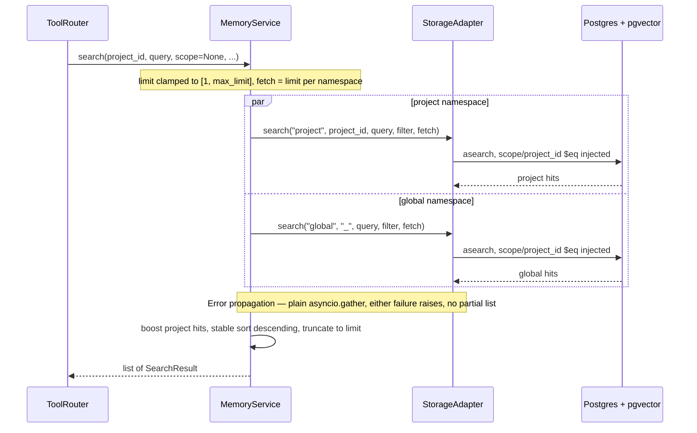
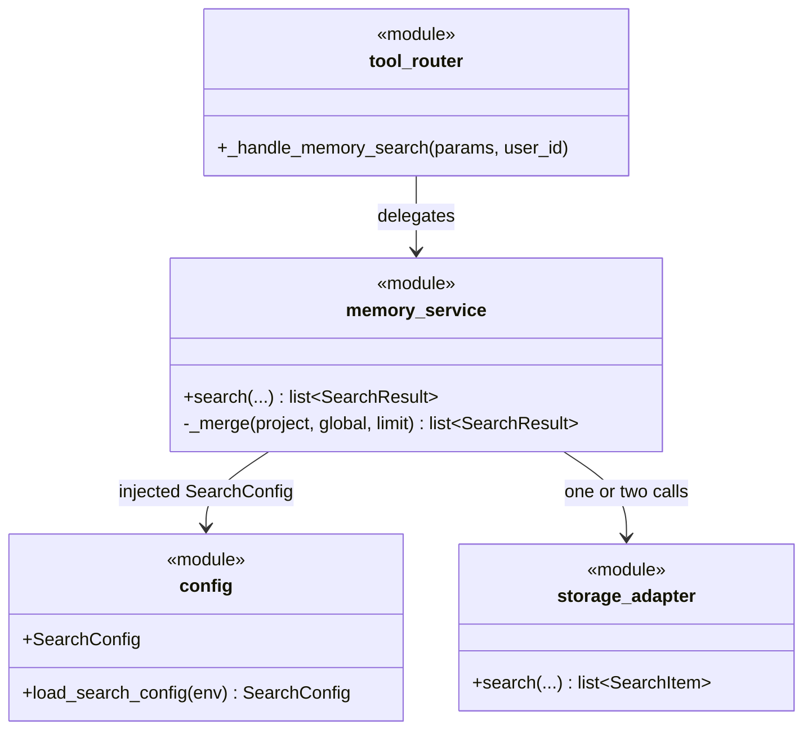
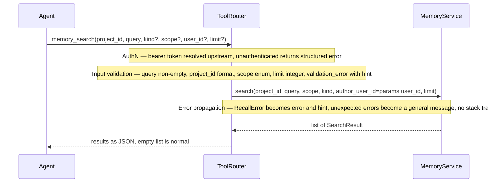

# LLD — Epic 2: Search

## Document Control

| Field | Value |
|-------|-------|
| Epic | E2 — Search |
| Phase | 2 |
| Epic issue | REC-2 |
| Task issues | REC-3 (E2.1), REC-4 (E2.2), REC-5 (E2.3), REC-6 (E2.4), REC-7 (E2.5, router hardening, runs before REC-6) |
| HLD components | Memory Service, Tool Router, Storage Adapter |
| ADRs | 0001 (flat schema), 0002 (namespace), 0004 (filters), 0010 (ranking), 0012 (real Postgres), 0015 (scope-explicit IDs) |
| Status | Approved — REC-3 (PR #122), REC-4 (PR #125), REC-5 (PR #126) and REC-7 (PR #127) implemented, REC-6 pending |
| Parent | [v2-design.md](../v2-design.md) |
| Requirements | [Epic 2](../../requirements/v2-requirements.md#epic-2-memory-retrieval--search) |

> **Provenance.** This LLD was reconstructed on 2026-11-19. The original was written
> before REC-3 but never committed, so REC-3 was implemented from its issue body alone.
> The task issue bodies (REC-3 to REC-7) carry the detailed contracts and BDD specs; this
> document is now their source of truth, and the issues link here.

## Open questions

| # | Question | Resolution |
|---|----------|------------|
| OQ1 | ADR-0010 claims "one embedding call per search". Is it achievable? | **No.** `asearch(query=...)` embeds internally per call, with no pre-computed-vector parameter (`langgraph-checkpoint-postgres` 3.0.5). A merged search makes **two** embedding calls. REC-5 amends ADR-0010's Consequences. Memoisation at the composition root (`PostgresIndexConfig(embed=...)`) is the mitigation if cost matters (E4.1). |
| OQ2 | Does cross-project search exist? | **No.** No `project_ids` parameter. Revisit only with the project registry (ADR-0014). |

---

# Part A — Human-Reviewable Design

## 2.1 Storage vector search

**Stories:** 2.1 (storage half), 2.3 (ADR-0004 key guard), 5.4 (namespace isolation on the search path)
**Layers:** BE

### Purpose

`StorageAdapter.search` gives the service one exact-namespace semantic query. `asearch` scopes
by namespace *prefix* (`store.prefix LIKE 'project.app%'`), so a search of project `app` would
also return `app-v2`. The adapter injects `scope`/`project_id` `$eq` filters to make scoping exact.
`put`/`get`/`delete` compile to `prefix = %s` and were never affected.

### Invariants

| # | Invariant | Verification |
|---|-----------|-------------|
| 1 | A search in project `app` never returns memories from `app-v2` | `test_prefix_overlapping_project_is_isolated` (real Postgres) |
| 2 | `scope`/`project_id` filters are added last, so a caller cannot override them | `TestScopingFilter.test_injects_scope_and_project_id` |
| 3 | Caller filter keys are limited to `{kind, user_id}` (ADR-0004) | `test_unsupported_filter_key_rejected` |
| 4 | Scores are the store's cosine similarity, unmodified | `test_scores_are_passed_through_unmodified` |
| 5 | One `search` call issues exactly one `asearch` | `test_single_round_trip` (`counting_adapter`) |

### Acceptance criteria

- [ ] `search(scope, project_id, query, filter=None, limit=10) -> list[SearchItem]`
- [ ] The scope/project invariant is enforced by the existing namespace builder, not re-implemented
- [ ] Caller filter keys outside `{kind, user_id}` raise `ValidationError` naming the key
- [ ] `kind` + `user_id` in one filter apply conjunctively
- [ ] Empty results return `[]`
- [ ] No raw SQL, no store subclass, no `offset`
- [ ] A call-counting test double over the real adapter exists (not a store subclass, not a mock)
- [ ] The two langgraph packages are pinned with a lower bound and an upper cap

### BDD specs

`TestStorageAdapterSearch` (`@pytest.mark.integration`, `store` fixture):
exact-content match scores highest · scores passed through unmodified · prefix-overlapping
project isolated · global namespace search · empty result is not an error · `kind` filter ·
`user_id` filter · `kind` + `user_id` conjunctive · unsupported key rejected · scope invariant
enforced · `limit` forwarded · single round trip.
`TestScopingFilter` (pure unit): injects `scope` and `project_id` · preserves caller keys.

## 2.2 Service search — scoped query, filters, snippets

**Stories:** 2.1 (service half), 2.3, 2.5
**Layers:** BE

### Purpose

`MemoryService.search` queries **one explicit scope**: it translates parameters into storage
filters, clamps the limit, and turns each hit into a snippet-bounded `SearchResult`. No merge and
no boost here; REC-5 adds both.

### `user_id` means two different things

| Where | Meaning | Source |
|-------|---------|--------|
| `memory_save` | the **caller** creating the memory | Auth (bearer token) |
| `memory_search`'s `user_id` | the **author to filter by** | tool parameters |

Passing the authenticated caller into `search` would restrict every search to the caller's own
memories and break Story 5.2 AC3. Single-user tests pass either way, so nothing would catch it.
The service parameter is therefore `author_user_id`, default `None`. The authenticated user
reaches the router's log line only, never `search`.

### Invariants

| # | Invariant | Verification |
|---|-----------|-------------|
| 1 | A search with no `author_user_id` returns other users' memories | `test_other_users_memories_visible_by_default` |
| 2 | Explicit scope: one adapter call, `limit = effective_limit` (no over-fetch), no boost | `test_explicit_scope_issues_one_query`, `..._does_not_over_fetch`, `..._applies_no_boost` |
| 3 | Snippet is `content[:snippet_max_chars]`, no ellipsis, short content byte-identical | `TestMemoryServiceSearchSnippets` |
| 4 | `SearchResult.project_id` is non-optional (global hits carry `"_"`) so ADR-0015 tools can act on a result | `test_global_result_carries_sentinel_project_id` |
| 5 | `memory_service.py` never reads the environment | `grep -c environ src/recall/memory_service.py` returns 0 |
| 6 | A `SearchItem` with `score=None` (store parse failure) maps to score `0.0` | pure unit test of `_to_result` on a constructed `SearchItem` (`test_none_score_maps_to_zero`) |

### Acceptance criteria

- [ ] `search(project_id, query, scope, kind=None, author_user_id=None, limit=None) -> list[SearchResult]`, `scope` required at this stage
- [ ] `limit` defaults to 10 and clamps to `[1, 50]`
- [ ] Each result carries `id, scope, project_id, kind, title, snippet, score`
- [ ] No `tags` parameter (ADR-0004) and no `project_ids` parameter
- [ ] Search settings come from an injected config object with documented defaults, so E1 call sites are unchanged; the loader is a pure function of an env mapping
- [ ] `load_search_config` fails fast, naming the variable, on an unparseable value, `default_limit > max_limit`, or `project_boost` outside ADR-0010's `(0.02, 0.17)`

### Config knobs

| Field | Env var | Default | Rationale |
|-------|---------|---------|-----------|
| `project_boost` | `RECALL_PROJECT_BOOST` | `0.05` | Inside ADR-0010's `(0.02, 0.17)`: wide enough that hits within 0.02 resolve to project, narrow enough that a 0.92 global hit still beats a 0.75 project hit |
| `default_limit` | `RECALL_DEFAULT_LIMIT` | `10` | Matches the store default |
| `max_limit` | `RECALL_MAX_LIMIT` | `50` | Bounds context-window damage |
| `snippet_max_chars` | `RECALL_SNIPPET_MAX_CHARS` | `200` | Story 2.5's default |

### BDD specs

`TestMemoryServiceSearchScoped` · `...SearchFilters` · `...SearchSnippets` · `...SearchLimits`
(integration, `service` / `counting_adapter`) and `TestLoadSearchConfig` (pure unit, env passed as
a dict, no monkeypatching). Cases: scope project excludes global · scope global excludes project ·
no boost on explicit scope · one query · no over-fetch · `kind` filter · author filter ·
conjunctive filters (incl. `kind` + `scope`, Story 2.3 AC6) · other users visible · no filters spans kinds · snippet truncation · short
content unaltered · result shape · global sentinel · default/explicit/clamped limit · empty result ·
config defaults/overrides/unparseable/`default_limit > max_limit`/boost out of bounds.

## 2.3 Merge — ADR-0010 project + global ranking

**Stories:** 2.2
**Layers:** BE

### Purpose

When `scope` is omitted, query both namespaces concurrently and merge with ADR-0010's additive
project boost: project hits score `raw + project_boost`, global hits `raw`. The boost is a
tie-breaker, never an override of relevance.

**No fetch headroom.** ADR-0010 prescribes fetching `limit + boost_window` per namespace. The boost
adds the same amount to every hit of a namespace, so it never reorders hits within one namespace, and
any hit below that namespace's top `limit` cannot reach the merged top `limit`. The extra rows are
never shown, so each namespace is fetched at exactly `limit` and the knob is removed. REC-5 records
this in the same ADR-0010 amendment as OQ1.

**Score semantics.** The returned `score` is the *ranking* score, so a merged search returns
`raw + project_boost` for project hits (it can exceed 1.0) while an explicit-scope search returns the
raw cosine similarity. The list is therefore always visibly sorted high to low. Tool descriptions
and docs call it a relevance score, not a cosine value.

**Known risk — filtered recall at scale.** The vector index returns its nearest candidates across all
rows, and `asearch` applies the namespace and filter predicates afterwards. Once one project is a
small share of the table, a search can return fewer than `limit` results, or none. Small test
fixtures cannot show it. Accepted for v2 (single container, one team): mitigation is a pgvector
setting (iterative scan or a higher `hnsw.ef_search`), deferred to E4 operations.

### Behavioural flow



### Structural overview



### Invariants

| # | Invariant | Verification |
|---|-----------|-------------|
| 1 | Tie resolves to project; a strong global hit beats a weak project hit | `TestMemoryServiceMergeRanking` (planted data) |
| 2 | List is built project-first and sorted with a stable sort, so ties stay deterministic even at `project_boost = 0` | unit test with `project_boost = 0` |
| 3 | A failure in either query propagates, no `return_exceptions=True` | `test_global_query_failure_propagates` (`failing_adapter`) |
| 4 | Default search issues exactly two adapter calls, each at exactly `limit` (no headroom, see §2.3) | `test_default_search_issues_two_queries`, `test_merge_fetches_exactly_limit` |
| 5 | Results sorted by descending score, truncated to the effective limit | `test_results_ranked_by_descending_score`, `test_merge_truncates_to_limit` |

### Acceptance criteria

- [x] `scope` optional; omitted means both namespaces via `asyncio.gather`
- [x] Explicit `scope` keeps REC-4 behaviour: one query, no boost, no over-fetch
- [x] A failure-injecting double over the real adapter raises on the global namespace only
- [x] ADR-0010 Consequences amended for OQ1 (two embedding calls); no memoisation implemented here

### Test-data planting recipe

<a id="LLD-e2-planting-recipe"></a>

`StubEmbeddingsProvider` is a SHA-256 hash embedder with **no semantic structure**: cosine similarity
is `1.0` only for byte-identical indexed text, and any two distinct strings score about 0 with
σ ≈ 0.026 at dims=1536. `save` indexes `["content"]`. So:

- **Make a memory the top hit:** set the query byte-identical to its `content`.
- **Tie:** two memories in different scopes with byte-identical `content`, query that string. Both score 1.0, so the boost decides.
- **Strong global beats weak project:** global `content` byte-identical to the query, project `content` different. Global scores 1.0, project about 0 + 0.05.
- Never assert graded similarity between different strings, it is flaky by construction.
- For the stub only: `project_boost = 0.05` is about 2σ of its noise, so planted-data assertions stay stable. Do not change the constant or the embedder in isolation.

### BDD specs

`TestMemoryServiceMergeRanking` (integration): tie favours project · strong global outranks weak
project · both scopes in one list, each tagged · descending scores · two queries · each fetched at exactly `limit` ·
global failure propagates · truncation to limit.

## 2.5 Tool Router hardening

**Stories:** 4.3 AC4 (no stack traces), ADR-0011 (one `mcp_call` event per call)
**Layers:** BE. Runs **before** REC-6 although numbered 2.5; it changes behaviour shared by all tools.

### Purpose

E1.6's router catches only `RecallError` and logs a thin event. This task closes both gaps for every
tool, so `memory_search` (REC-6) inherits correct behaviour instead of carrying router changes itself.

### Invariants

| # | Invariant | Verification |
|---|-----------|-------------|
| 1 | An unexpected exception reaches the agent as a general `{error, hint}`, never a stack trace | `test_internal_error_is_generalised` |
| 2 | Exactly one `mcp_call` event per call, success or failure | `test_one_log_event_per_call` |
| 3 | The event carries `request_id`, `user_id`, `project_id`, `tool`, `kind`, `scope`, `latency_ms`, `result_status`; it also carries `result_count` when the tool result contains a `results` list (search), and omits it otherwise | `test_mcp_call_event_fields` |
| 4 | Existing E1 log assertions still pass (`result_status` keeps its name) | existing `tests/test_tool_router.py` unchanged |

### Acceptance criteria

- [ ] Catch-all in `handle_tool_call` logs the cause server-side and returns a general error
- [ ] The log event is extended for all tools
- [ ] A `captured_logs` fixture exists (structlog capture)

### BDD specs

`TestRouterHardening`: unexpected exception generalised · one event per call · event carries the
required fields · `memory_save`/`memory_get` events keep working.

## 2.4 `memory_search` MCP tool

**Stories:** 2.1, 2.2, 2.3, 2.5 (transport surface), 4.2 (agent-oriented description), 4.4 (tool budget)
**Layers:** BE

### Purpose

Declare `memory_search` on the MCP surface with a thin validating handler, and prove ADR-0010's
ranking properties over real transport against real Postgres. This is the Phase 2 exit criterion.

### Behavioural flow

Wire path: Agent → MCP transport → `ToolRouter.handle_tool_call` → `_handle_memory_search` →
`MemoryService.search` (flow in §2.3). Boundary behaviour:



**AuthZ posture (stated, not inferred).** Any authenticated user may search **any** `project_id`;
it is validated for format only. Deliberate for v2: the project registry is deferred (ADR-0014),
so there is nothing to authorise against, and Story 5.2 AC3 makes memories shared within a project
by design. Accepted risk: a user who guesses another team's `project_id` on the same server can
read its memories. Revisit if Story 5.3 is reinstated.

### Invariants

| # | Invariant | Verification |
|---|-----------|-------------|
| 1 | The wire `user_id` maps to `author_user_id`; the authenticated caller is logging-only | `test_caller_identity_is_not_the_author_filter` (alice's token returns bob's memories) |
| 2 | Handler is parse, delegate, return, and touches no store, adapter or embedder | AST unit test: the handler body references no `storage`/`embed` names |
| 3 | The `mcp_call` event never carries `query`, `title`, `snippet` or `content` | `test_content_and_query_never_logged` |
| 4 | An empty result is `[]`, never an error | `test_empty_results_not_an_error` |
| 5 | At most 6 tools are exposed | `TestToolBudget.test_at_most_six_tools` |

### Acceptance criteria

- [ ] Declared with exactly `project_id`, `query`, `kind?`, `scope?`, `user_id?`, `limit?`
- [ ] Description covers purpose, when to call, the project+global default, `scope` restriction, `kind="instruction"`, each parameter's type and constraints, and that an empty list is normal
- [ ] `project_id` validated through `validate_project_id_format`
- [ ] `query` is rejected with `validation_error` above 2,000 characters (each search embeds it twice, so length is a cost path once a paid embedder is wired in E4)
- [ ] Structured `{error, hint}` for: missing or empty `query`, malformed `project_id`, invalid `scope`, non-integer `limit`, unauthenticated (unexpected errors: REC-7)
- [ ] The composition root loads the search config from the environment once and injects it
- [ ] Error formatting and `mcp_call` logging go through the existing single path
- [ ] E2E tests prove the ranking properties with planted data

### BDD specs

`TestMemorySearchTool`, `TestSearchRankingEndToEnd`, `TestToolBudget` (integration). Cases: merged
ranked list · result shape over transport · empty not an error · `kind` filter · scope restriction ·
caller is not the author filter · requires auth · missing query · invalid `project_id` · invalid
`scope` · query over 2,000 chars rejected · content and query never logged ·
planted tie favours project · strong global beats weak project · at most six tools · description
documents the scope default.

---

# Part B — Agent Implementation Detail

## External Surfaces

| Surface | Version / revision | Doc URL | Verified | New to repo |
|---------|--------------------|---------|----------|-------------|
| `langgraph-checkpoint-postgres` (`AsyncPostgresStore.asearch`) | `>=3.0.5,<4` (behaviour read on 3.0.5) | [base.py](https://github.com/langchain-ai/langgraph/blob/checkpointpostgres%3D%3D3.0.5/libs/checkpoint-postgres/langgraph/store/postgres/base.py) | Yes, `LIKE` predicate at `base.py:446` of the installed 3.0.5 source | No |
| `langgraph` (`SearchItem`) | `>=1.1,<2` | [store/base](https://github.com/langchain-ai/langgraph/blob/main/libs/checkpoint/langgraph/store/base/__init__.py) | Yes, imported in `storage_adapter.py` | No |
| MCP SDK (`memory_search` tool declaration) | `mcp>=2.0.0` (no upper cap in `pyproject.toml`), spec 2026-07-28 | [MCP spec](https://modelcontextprotocol.io/specification) | Unverified, mirrors the `memory_save`/`memory_get` pattern already in `server.py` | No |

## Reused helpers — DO NOT re-implement

| Helper | Import path | Replaces |
|--------|-------------|----------|
| `StorageAdapter._build_namespace` | `recall.storage_adapter` | any inline scope/project invariant check |
| `validate_project_id_format` | `recall.validation` | an inline `^[a-zA-Z0-9_-]{1,128}$` regex |
| `ToolRouter.handle_tool_call` / `_log_call` / `_missing_fields` | `recall.tool_router` | a second error-formatting or logging path |
| `StubEmbeddingsProvider` (wired by the `store` fixture) | `recall.embeddings.stub` | a custom test embedder |
| `RecallError` / `ValidationError` | `recall.errors` | ad-hoc exceptions |

<a id="LLD-e2-storage-search"></a>

## 2.1 Storage vector search — Implementation

**Status: implemented (PR #122).** Files: `src/recall/storage_adapter.py`, `tests/conftest.py`
(`counting_adapter`), `tests/test_storage_adapter.py`, `pyproject.toml` pins.

```python
async def search(self, scope: str, project_id: str, query: str,
                 filter: dict[str, Any] | None = None, limit: int = 10) -> list[SearchItem]
@staticmethod
def _validate_filter_keys(filter: dict[str, Any] | None) -> None   # ADR-0004, {kind, user_id}
@staticmethod
def _scoping_filter(scope, project_id, filter) -> dict[str, Any]   # {**filter, scope, project_id}, added last
```

> **Constraint:** do not remove or "simplify away" `_scoping_filter`. It is the only thing
> closing the `LIKE`-prefix leak. Caller keys `scope`/`project_id` are rejected by
> `_validate_filter_keys` (outside `{kind, user_id}`), not silently overridden.

`counting_adapter` wraps a real `StorageAdapter` and counts `search` calls and arguments. It is an
adapter decorator: not a store subclass, not a mock (ADR-0012).

<a id="LLD-e2-service-search"></a>

## 2.2 Service search — Implementation

#### File structure

```text
src/recall/config.py          — NEW: SearchConfig, load_search_config
src/recall/models.py          — SearchResult
src/recall/memory_service.py  — search, _clamp_limit, _build_filter, _to_result, _snippet
tests/test_config.py          — NEW: TestLoadSearchConfig
tests/test_memory_service.py  — four new search test classes
```

#### Internal types

```python
@dataclass(frozen=True)
class SearchConfig:
    project_boost: float = 0.05
    default_limit: int = 10
    max_limit: int = 50
    snippet_max_chars: int = 200

class SearchResult(BaseModel):
    id: str; scope: str; project_id: str; kind: str
    title: str; snippet: str; score: float
```

#### Function signatures

```python
def load_search_config(env: Mapping[str, str]) -> SearchConfig   # pure, raises ValidationError naming the variable
def _parse[T: (int, float)](env, name, cast, default) -> T         # private: env lookup + cast, ValidationError naming `name`

class MemoryService:
    def __init__(self, storage: StorageAdapter, search_config: SearchConfig | None = None) -> None
    async def search(self, project_id: str, query: str, scope: str,
                     kind: str | None = None, author_user_id: str | None = None,
                     limit: int | None = None) -> list[SearchResult]
    def _clamp_limit(self, limit: int | None) -> int                       # default, then [1, max_limit]
    @staticmethod
    def _build_filter(kind: str | None, author_user_id: str | None) -> dict[str, str] | None  # user_id key = author
    def _to_result(self, item: SearchItem, score: float) -> SearchResult   # score None handled by caller as 0.0
    def _snippet(self, content: str) -> str                                # content[:snippet_max_chars], no ellipsis
```

> **Constraint:** `project_id` for a global search is `GLOBAL_SENTINEL` (`"_"`), taken from the
> stored record, never from the request.

#### Error handling

`ValidationError` from the adapter (scope invariant, filter keys) propagates unchanged. Config errors
raise at startup, never in a request path.

<a id="LLD-e2-merge"></a>

## 2.3 Merge — Implementation

Edits `memory_service.py` (`scope` optional, `_merge`), `tests/conftest.py` (`failing_adapter`),
`tests/test_memory_service.py`, and the ADR-0010 Consequences.

```python
async def search(self, project_id, query, scope: str | None = None, ...) -> list[SearchResult]
    # scope None: asyncio.gather(project query, global query) at `limit`, then _merge
def _merge(self, project: list[SearchResult], glob: list[SearchResult], limit: int) -> list[SearchResult]
    # boost project scores, concatenate project-first, sorted(..., key=score, reverse=True) (stable), [:limit]
```

> **Constraint:** plain `asyncio.gather`, no `return_exceptions=True`. A list silently missing
> global memories is worse than an error (requirements §Observability).

**ADR-0010 amendment.** Replace the Consequences bullet "One embedding call per search regardless of
how many namespaces are queried" with a note that a merged search makes two embedding calls for
byte-identical text (OQ1), and that memoisation at the composition root is the mitigation if
embedding cost becomes material (E4.1). Do not implement memoisation here.

`failing_adapter` wraps a real adapter and raises on the `("global", "_")` namespace only.

<a id="LLD-e2-router-hardening"></a>

## 2.5 Tool Router hardening — Implementation

```text
src/recall/tool_router.py     — catch-all in handle_tool_call, extended _log_call
tests/test_tool_router.py     — TestRouterHardening
tests/conftest.py             — captured_logs fixture
```

Two E1.6 behaviours fall short of the criteria and are fixed in the existing single path:

1. `handle_tool_call` catches only `RecallError`. Add a catch-all that logs the cause server-side
   and returns `{"error": "internal_error", "hint": "An unexpected error occurred. Retry; if it persists, contact the server operator."}`
   with no stack trace (Story 4.3 AC4). The hint advises a retry because the failure is not classified.
2. `_log_call` emits `tool, user_id, project_id, latency_ms, result_status`. New signature:
   `_log_call(tool_name, params, user_id, start, result_status, result_count: int | None = None)`.
   `result_count` is set by `handle_tool_call` from the tool result (`len(result["results"])` for
   search, `None` otherwise). `kind` and `scope` are read from `params` (empty string when absent).
   `request_id` arrives through the structlog context bound by `RequestContextMiddleware`.
   `result_status` keeps its name (E1 assertions unchanged); the criterion's `status` is satisfied by it.

| Tool | `kind` | `scope` | `result_count` |
|------|--------|---------|----------------|
| `memory_save` | from params | from params | absent |
| `memory_get` | absent | from params | absent |
| `memory_search` | from params | from params, empty when searching both | `len(results)` |

<a id="LLD-e2-search-tool"></a>

## 2.4 `memory_search` tool — Implementation

E1.6 (PR #117) has landed, so `tool_router.py` and the MCP mount exist.

```text
src/recall/tool_router.py     — _handle_memory_search, _parse_search_params, dispatch entry
src/recall/server.py          — MEMORY_SEARCH_DESCRIPTION/SCHEMA, tool declaration, load_search_config wiring
tests/test_tool_router.py     — param validation and error formatting
tests/test_e2e_search.py      — NEW: end-to-end and ranking properties
```

Named `test_e2e_search.py`, not `test_e2e_phase2.py`: phase numbers are not modules
(`kb/conventions.md`). `run-e2e.sh` is a no-op here, so these are integration tests marked
`@pytest.mark.integration`.

```python
class _SearchParams(NamedTuple):
    query: str            # non-empty, ≤ _MAX_QUERY_CHARS (2000, module constant)
    project_id: str       # validate_project_id_format
    scope: str | None     # "project" | "global" | None (both)
    kind: str | None
    author_user_id: str | None   # wire "user_id"
    limit: int | None     # must be an int, clamped by the service

async def _handle_memory_search(self, params: dict[str, Any]) -> dict[str, Any]
    # ≤ 15 lines: _parse_search_params, MemoryService.search, return {"results": [r.model_dump() ...]}
@staticmethod
def _parse_search_params(params: dict[str, Any]) -> _SearchParams
```

> **Constraint:** the wire result is `{"results": list[SearchResult]}`; an empty search is
> `{"results": []}`. This matches `handle_tool_call`'s `dict[str, Any]` return. The handler takes
> `params` only, as `_handle_memory_get` does, so the authenticated caller cannot reach `search`.
>
> **Fixtures.** `mcp_client`, `unauthenticated_client` and `captured_logs` do not exist anywhere in
> `tests/` (checked 2026-11-19); `project_id` exists only in `tests/test_e2e_phase1.py`. REC-7 adds
> `captured_logs`. REC-6 adds `mcp_client` and `unauthenticated_client` to `tests/conftest.py` and moves
> `project_id` there rather than duplicating it.

## kb/ additions

Add to `kb/architecture.md` as part of REC-4:

```markdown
- `src/recall/config.py` — `SearchConfig` + pure `load_search_config(env)`. Inject via constructors; never read `os.environ` in request paths or in `memory_service.py`.
- `StorageAdapter.search` — exact-namespace semantic search; injects `scope`/`project_id` `$eq` filters to close the store's `LIKE`-prefix leak. Never call `asearch` directly.
```

---

## Cross-References

### Internal

- §2.1 depends on: none
- §2.2 depends on: [§2.1](#LLD-e2-storage-search)
- §2.3 depends on: [§2.2](#LLD-e2-service-search)
- §2.5 depends on: [§2.3](#LLD-e2-merge)
- §2.4 depends on: [§2.5](#LLD-e2-router-hardening), and E1.6 (merged)

### External

- Depends on: [lld-e1-one-memory-e2e.md](lld-e1-one-memory-e2e.md) (`MemoryService`, `ToolRouter`, `StorageAdapter`)
- Depended on by: E3 (`memory_update`/`memory_delete` consume `SearchResult.scope` + `project_id`, ADR-0015)

### Shared types

`SearchResult` (§2.2), `SearchConfig` (§2.2), `SearchItem` (langgraph, §2.1).

---

## Tasks

| Task | Issue | Title | Layer | Depends on | Status |
|------|-------|-------|-------|------------|--------|
| 1 | REC-3 | Storage adapter vector search | BE | none | Implemented (PR #122) |
| 2 | REC-4 | Memory Service search: scoped query, filters, snippets | BE | Task 1 | Implemented (PR #125) |
| 3 | REC-5 | Memory Service merge: ADR-0010 ranking | BE | Task 2 | Implemented (PR #126) |
| 4 | REC-7 | Tool Router hardening: catch-all errors, full `mcp_call` fields | BE | Task 3 | Implemented (PR #127) |
| 5 | REC-6 | `memory_search` MCP tool and ranking E2E tests | BE | Task 4 | Todo |

Acceptance criteria and BDD specs per task are in §2.1 to §2.5 above; the issue bodies add
file-level detail.

## Execution Order


Waves are strictly sequential (REC-3, REC-4, REC-5, REC-7, REC-6): each task edits files the next one extends.
