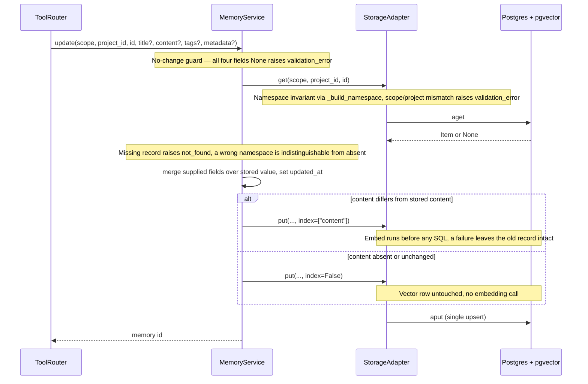
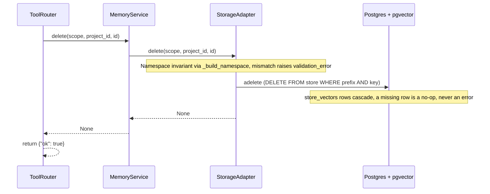
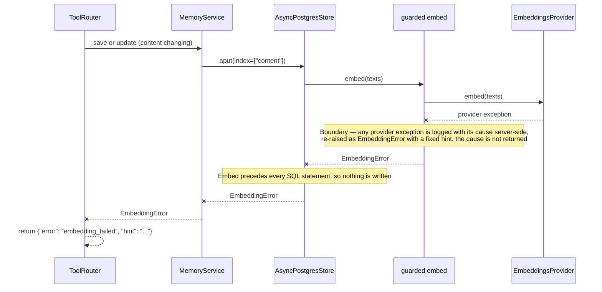
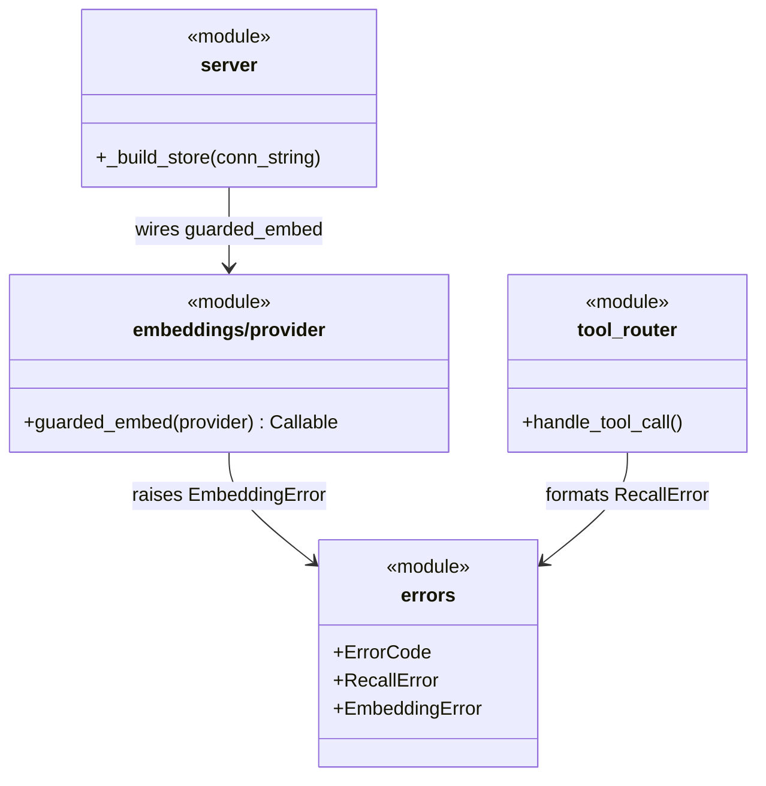
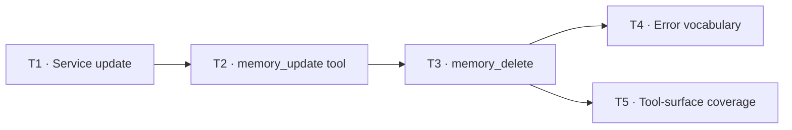

# LLD — Epic 3: Update, delete, full tool surface

## Document Control

| Field | Value |
|-------|-------|
| Epic | E3 — Update, delete, full surface |
| Phase | 3 |
| Epic issue | REC-8 |
| Task issues | REC-9 (§3.1), REC-10 (§3.2), REC-11 (§3.3), REC-12 (§3.4), REC-13 (§3.5) |
| HLD components | Memory Service, Tool Router, Embedder (composition root) |
| ADRs | 0001 (flat schema), 0002 (namespace), 0008 (embeddings provider), 0011 (observability), 0012 (real Postgres), 0014 (no project registry), 0015 (scope-explicit IDs) |
| Status | Revised |
| Parent | [v2-design.md](../v2-design.md) |
| Requirements | Stories 1.4, 1.5, 4.2 (update/delete descriptions), 4.3 — [requirements v0.4](../../requirements/v2-requirements.md) |
| Plan | [Phase 3](../../plans/2026-04-12-v2-implementation-plan.md) (E3.1 update, E3.2 delete, E3.3 errors) |
| Revised | 2026-11-23 — REC-10: §3.2; REC-11: §3.3; REC-12: §3.4; REC-13: §3.5 |

## Decisions taken at the architect gate (2026-11-21)

| # | Decision | Recorded in |
|---|----------|-------------|
| D1 | `title`, `content`, `tags`, `metadata` are updatable. `scope`, `project_id`, `kind`, `user_id` (author) are immutable and rejected by name. | requirements v0.4, Story 1.4 |
| D2 | `tags` and `metadata` are **replaced wholesale** (a merge cannot delete a key; agents `memory_get` then send the new value). | requirements v0.4 |
| D3 | Only a change to `content` re-embeds. | §3.1 |
| D4 | The error vocabulary is `unauthenticated`, `validation_error`, `not_found`, `embedding_failed`, `internal_error`. The plan's `unknown_project` is dropped: ADR-0014 deferred the registry, so nothing can raise it. It returns with the registry. | §3.4, requirements v0.4 |
| D6 | `scope` and `project_id` are the call's namespace locators (ADR-0015), so an update cannot express a change to them: a memory in another namespace is `not_found`. Only `kind`, `user_id`, `created_at`, `updated_at` are rejected by name. | requirements v0.5, Story 1.4 |
| D5 | The wire shape stays `{error: <code>, hint: <detail>}`. Story 4.3's wording was corrected to match. | requirements v0.4 |

## Open questions

| # | Question | Resolution |
|---|----------|------------|
| OQ1 | Update is read-modify-write (`get` then `put`), so two concurrent updates lose one, and an update racing a delete re-creates the memory. | **Accepted for v2** (single container, one team). Closing it needs a row lock, which is raw SQL on the store and against the "boring storage" principle. Last writer wins. Revisit with E4 operations if it is observed. |
| OQ2 | `MemoryRecord.user_id` is commented "who created/last updated". Which is it? | **Creator.** `search`'s `author_user_id` filter (E2) already treats it as the author. Update never changes it; §3.1 corrects the comment. |
| OQ3 | `save` and `update` accept unbounded `content`, `tags` and `metadata`. | **Out of scope**, same gap as `save` today. Flag for E4 (config limits). Not designed here. |

---

# Part A — Human-Reviewable Design

## 3.1 Service update — re-embed only on content change

**Stories:** 1.4, 1.2 (scope invariant on the update path)
**Layers:** BE

### Purpose

`MemoryService.update(scope, project_id, memory_id, ...)` replaces the supplied fields of one
existing memory and bumps `updated_at`. It decides whether to re-embed (the Embedder never does,
HLD §Embedder); a store write embeds whatever `index` names, so the service chooses
`index=["content"]` when `content` changes and `index=False` otherwise.

`index=False` keeps the stored vector and embedding precedes any SQL, so an embedding failure on a content update leaves the old record intact (verified, see External Surfaces). `aput` is an upsert, so the service must `get` first.

### Behavioural flow



### Invariants

| # | Invariant | Verification |
|---|-----------|-------------|
| 1 | A metadata-only (title, tags, metadata) update makes **zero** embedding calls | `test_metadata_only_update_does_not_re_embed` (`embed_calls` fixture) |
| 2 | A content change makes exactly one embedding call and replaces the vector (search for the new content finds it, the old content no longer scores 1.0) | `test_content_update_re_embeds_and_replaces_vector` |
| 3 | An update to a missing id, or to the right id in the wrong namespace, raises `NotFoundError` and creates nothing | `test_update_missing_id_not_found`, `test_update_wrong_namespace_not_found` |
| 4 | `scope`, `project_id`, `kind`, `user_id`, `created_at` are never changed by `update` | `test_immutable_fields_preserved` |
| 5 | A failed embedding on a content update leaves the stored record byte-identical | `test_failed_content_update_leaves_record_intact` (inline failing-embed store, the pattern of `test_save_embedding_failure_persists_nothing`) |
| 6 | `update` with no fields raises `ValidationError` before any storage call | `test_update_with_no_fields_rejected` (`counting_adapter.aget_calls == 0`) |

### Acceptance criteria

- [ ] `update(scope, project_id, memory_id, title=None, content=None, tags=None, metadata=None) -> str` returns the id
- [ ] Supplied fields replace stored ones; `tags` and `metadata` replace wholesale; `updated_at` is set to now (UTC ISO-8601); `created_at` and `user_id` unchanged
- [ ] `content` identical to the stored value counts as no content change (no re-embed)
- [ ] All four fields `None` raises `ValidationError("No fields to update: ...")`
- [ ] Missing memory raises `NotFoundError`; the write is a single `put`
- [ ] `_CountingStore` (conftest) also counts `aget`, `aput` and `adelete` (`aget_calls`, `aput_calls`, `adelete_calls`), still a forwarding decorator
- [ ] `embed_calls` fixture added to `tests/conftest.py`: wraps the real stub, records each batch; not a mock (ADR-0012)
- [ ] `MemoryRecord.user_id` comment corrected to "author (creator)" (OQ2)

### BDD specs

`TestMemoryServiceUpdate` (integration): content update replaces content and bumps `updated_at` ·
tags replaced · metadata replaced wholesale · title updated and searchable · metadata-only update does
not re-embed · content update re-embeds once · same-content update does not re-embed · missing id not
found · wrong namespace not found · no fields rejected · author and `created_at` preserved · scope
invariant violation propagates · other user's memory is updatable (Story 5.2: shared within a project).

## 3.2 `memory_update` MCP tool

**Stories:** 1.4, 4.2
**Layers:** BE

### Purpose

Expose §3.1 as the fourth MCP tool. The router validates the boundary (required fields, immutable
fields, types), delegates, and returns `{"id": ...}`. The tool description is a prompt (Story 4.2): it
says when to update instead of saving, that `tags`/`metadata` replace wholesale, and what to do for an
immutable field (save a new memory, delete the old).

Story 1.4 AC7 ("attempts to change scope or project ID"): `scope` and `project_id` are the
*namespace locators* of the call (ADR-0015), so they cannot express a change. A memory that lives in
another namespace is `not_found`. `kind`, `user_id`, `created_at` and `updated_at` are rejected by name.

### Invariants

| # | Invariant | Verification |
|---|-----------|-------------|
| 1 | The authenticated caller never reaches `update`, so authorship cannot be rewritten | `test_update_does_not_change_author` (alice saves, bob updates, `user_id` still alice) |
| 2 | Immutable fields in the payload are rejected, naming the field | `test_immutable_field_rejected[kind,user_id,created_at,updated_at]` |
| 3 | Validation errors precede storage access | `test_invalid_update_issues_no_storage_call` (`counting_adapter.aget_calls == 0`) |
| 4 | Tool count stays ≤ 6 (4 after this task, 5 after §3.3) | `TestToolBudget.test_at_most_six_tools` (existing) |

### Acceptance criteria

- [ ] `memory_update` listed with description and schema (required `scope`, `project_id`, `id`; optional `title`, `content`, `tags`, `metadata`)
- [ ] Missing `scope`/`project_id`/`id` → `validation_error`; empty payload → `validation_error` naming the four fields
- [ ] `kind`/`user_id`/`created_at`/`updated_at` in params → `validation_error` naming the field
- [ ] `content`/`title` must be non-empty strings; `tags` a list of strings; `metadata` an object. `[]` and `{}` are valid and clear the field; a JSON `null` or an absent key means "not supplied"
- [ ] Unknown id → `{"error": "not_found", ...}`
- [ ] Happy path returns `{"id": <id>}`; a following `memory_get` shows the change; unchanged-embedding case verified through `memory_search`
- [ ] `mcp_call` event emitted once per call, `result_status` `ok` or the error code

### BDD specs

`TestMemoryUpdateTool` (integration, over the transport): content update round-trips through get and
search · metadata-only update keeps search ranking · title update · empty payload · immutable field
rejected · bad types · empty `tags`/`metadata` clear the field · null treated as not supplied · unknown id · cross-namespace id · requires auth · logs one `mcp_call`.

## 3.3 `memory_delete` MCP tool

**Stories:** 1.5, 4.2
**Layers:** BE

### Purpose

Permanently remove one memory by `(scope, project_id, id)`. Idempotent: deleting an absent id
succeeds. `store_vectors` rows are removed by the store's `ON DELETE CASCADE` foreign key
(`langgraph/store/postgres/base.py` DDL), so there is no separate embedding cleanup.

### Behavioural flow



### Invariants

| # | Invariant | Verification |
|---|-----------|-------------|
| 1 | After delete, `get` is `not_found` and `search` never returns the id | `test_deleted_memory_absent_from_get_and_search` |
| 2 | After delete, no `store_vectors` row remains for the key | `test_delete_removes_embedding_row` (real connection, `SELECT count(*)`) |
| 3 | Deleting an absent id returns ok, twice in a row | `test_delete_is_idempotent` |
| 4 | Delete in namespace A never removes the same id in namespace B | `test_delete_wrong_namespace_leaves_memory` |
| 5 | Scope invariant holds on the delete path | `test_delete_scope_invariant_enforced` |

### Acceptance criteria

- [ ] `StorageAdapter.delete(scope, project_id, key) -> None` via `_build_namespace` then `adelete`
- [ ] `MemoryService.delete(scope, project_id, memory_id) -> None` (no existence check: idempotent)
- [ ] `memory_delete` tool returns `{"ok": true}`; description and schema declared
- [ ] Missing `scope`/`project_id`/`id` → `validation_error`; invalid scope pairing → `validation_error`
- [ ] Description tells the agent deletion is permanent and idempotent

### BDD specs

`TestStorageAdapterDelete` (integration) · `TestMemoryServiceDelete` (integration) ·
`TestMemoryDeleteTool` (integration, over the transport): invariants 1–5 plus requires auth ·
missing fields · `mcp_call` logged.

## 3.4 Error vocabulary

**Stories:** 4.3
**Layers:** BE

### Purpose

One registry for the codes agents can branch on, and the one code that is still unclassified today:
`embedding_failed`. Embedding failures surface from inside `AsyncPostgresStore.aput` as raw provider
exceptions, which the router's catch-all returns as `internal_error` (advice: retry, which is wrong
for a mis-configured provider). The wrap sits at the embed seam of the composition root, so every
write path (save, update) gets it and E4.1's real providers inherit it.

| Code | Class | Raised by | Agent action in `hint` |
|------|-------|-----------|------------------------|
| `unauthenticated` | `UnauthenticatedError` | auth | send the bearer header |
| `validation_error` | `ValidationError` | router, adapter | fix the named field (hint carries the detail) |
| `not_found` | `NotFoundError` | service `get`/`update` | verify the id or search first |
| `embedding_failed` | `EmbeddingError` (new) | embed seam: save, update **and search** (the store embeds the query through the same function) | retry; if persistent, tell the operator |
| `internal_error` | router catch-all | anything else | retry; contact the operator |

### Behavioural flow (embedding failure)



### Structural overview



### Invariants

| # | Invariant | Verification |
|---|-----------|-------------|
| 1 | Error codes are defined once, in `ErrorCode`; no code literal appears elsewhere in `src/` | the grep in §3.4 Part B (must print nothing), plus `test_error_code_vocabulary_is_exactly_five` |
| 2 | Every envelope is `{error: <ErrorCode value>, hint: <non-empty str>}` and nothing else | `TestErrorEnvelopes` (parametrised over all five codes) |
| 3 | A provider exception never leaks its message or type to the caller | `test_embedding_failure_does_not_leak_cause` |
| 4 | A failed embed leaves nothing written (save) and the old record intact (update) | `test_failed_save_persists_nothing`, §3.1 invariant 5 |
| 5 | `ValidationError.__str__` keeps returning the detail (existing callers match on it) | existing tests unchanged |

### Acceptance criteria

- [ ] `ErrorCode(StrEnum)` with the five members; every `RecallError` subclass and the router's catch-all use it; `RecallError.error` stays typed `str`
- [ ] `EmbeddingError(RecallError)`: `error = ErrorCode.EMBEDDING_FAILED`, fixed hint, cause logged server-side only
- [ ] `guarded_embed(provider)` in `embeddings/provider.py`, used by `server._build_store` and the test `store` fixture helper
- [ ] Existing envelopes unchanged on the wire (`error` serialises to the same strings)
- [ ] Each code has an envelope test through the real router; `embedding_failed` over a store whose provider raises

### BDD specs

`TestErrorEnvelopes` (parametrised): unauthenticated · validation_error · not_found · embedding_failed ·
internal_error, each asserting exactly `{error, hint}` · `test_embedding_failure_on_save` · `…_on_update` · `…_on_search`
· `test_embedding_failure_does_not_leak_cause` · `TestGuardedEmbed` (unit: passes vectors through,
wraps `RuntimeError`).

## 3.5 Tool-surface coverage (Phase 3 exit)

**Stories:** 4.3, 4.4 (exit criterion: every tool has a happy and an error path test)
**Layers:** BE (tests only)

### Purpose

Make the phase exit criterion executable and self-policing: a table-driven transport test with one
happy and one error case per tool, and a guard that fails when a tool is listed that has no row.

### Invariants

| # | Invariant | Verification |
|---|-----------|-------------|
| 1 | Every tool returned by `list_tools` has a happy-path case and an error-path case | `test_every_listed_tool_has_both_cases` |
| 2 | A sixth or seventh tool cannot be added without extending the table | same test, plus `TestToolBudget` |

### Acceptance criteria

- [ ] `tests/test_e2e_tool_surface.py` with `TOOL_CASES: dict[str, ToolCases]` for the five tools
- [ ] Error cases name the expected code as a string literal (tests may use literals, §3.4 invariant 1 scans `src/` only, and this keeps T5 independent of T4)
- [ ] No production code changed

### BDD specs

`test_happy_path[tool]` · `test_error_path[tool]` (parametrised over the five tools) ·
`test_every_listed_tool_has_both_cases`.

---

# Part B — Agent Implementation Detail

## External Surfaces

| Surface | Version / revision | Doc URL | Verified | New to repo |
|---------|--------------------|---------|----------|-------------|
| `AsyncPostgresStore.aput` overwrite with `index=False` (keeps vectors, upsert) and `adelete` |  `langgraph-checkpoint-postgres>=3.0.5,<4` (read on 3.0.5) | [base.py](https://github.com/langchain-ai/langgraph/blob/checkpointpostgres%3D%3D3.0.5/libs/checkpoint-postgres/langgraph/store/postgres/base.py) | Yes, installed source: `_prepare_batch_PUT_queries` skips vectors for `index is False`, `ON CONFLICT (prefix, key) DO UPDATE`; `aio.py::_batch_put_ops` embeds before executing; `BaseStore.adelete` is `PutOp(value=None)`; `store_vectors` FK is `ON DELETE CASCADE` (`base.py:112`) | **Yes** — `adelete` and overwrite-with-`index=False` are not used anywhere in the repo yet (`aput` of new keys, `aget`, `asearch` are) |
| `PostgresIndexConfig(embed=...)` exception propagation | same | same | Yes — installed `embed.py:209-211` (`EmbeddingsLambda` falls back to the sync function) and the existing `test_save_embedding_failure_persists_nothing` show a provider `RuntimeError` reaches the caller unchanged | No |
| MCP SDK tool declaration | `mcp>=2.0.0`, spec 2026-07-28 | [MCP spec](https://modelcontextprotocol.io/specification) | Mirrors `memory_save`/`memory_get`/`memory_search` in `server.py` | No |

## Reused helpers — DO NOT re-implement

| Helper | Import path | Replaces |
|--------|-------------|----------|
| `StorageAdapter.get` / `put` / `_build_namespace` | `recall.storage_adapter` | raw `store.aget/aput`, inline scope invariant |
| `ToolRouter.handle_tool_call` / `_log_call` / `_missing_fields` | `recall.tool_router` | a second error-formatting or logging path |
| `RecallError`, `ValidationError`, `NotFoundError` | `recall.errors` | ad-hoc exceptions |
| `validate_project_id_format`, `GLOBAL_SENTINEL` | `recall.validation`, `recall.storage_adapter` | inline regex, literal `"_"` |
| `store`, `service`, `counting_adapter` (extended in T1), `failing_adapter`, `captured_logs`, `app_factory`, `mcp_client`, `unauthenticated_client` | `tests/conftest.py` | new fixtures |
| `StubEmbeddingsProvider` | `recall.embeddings.stub` | a custom test embedder |
| `_PerCallClient` | `tests/conftest.py` | a second transport client |
| `_save` | `tests/test_e2e_search.py` | a second save helper |
| `_vector_row_count` | `tests/test_memory_service.py` | a second `store_vectors` row-count helper |

<a id="LLD-e3-service-update"></a>

## 3.1 Service update — Implementation

```text
src/recall/memory_service.py   — update, _apply_changes
src/recall/models.py           — MemoryRecord.user_id comment only
tests/conftest.py              — embed_calls fixture (store fixture records into it), _CountingStore counts aget/aput/adelete
tests/test_memory_service.py   — TestMemoryServiceUpdate
```

```python
async def update(
    self,
    scope: str,
    project_id: str,
    memory_id: str,
    title: str | None = None,
    content: str | None = None,
    tags: list[str] | None = None,
    metadata: dict[str, Any] | None = None,
) -> str:
    # 1. if all four None: raise ValidationError("No fields to update: provide at least one of title, content, tags, metadata")
    # 2. item = await self._storage.get(scope, project_id, memory_id); None -> NotFoundError(memory_id)
    # 3. value = self._apply_changes(item.value, title, content, tags, metadata)
    # 4. content_changed = content is not None and content != item.value["content"]
    # 5. await self._storage.put(scope, project_id, memory_id, value,
    #        index=["content"] if content_changed else False)
    # 6. return memory_id

@staticmethod
def _apply_changes(
    stored: dict[str, Any],
    title: str | None,
    content: str | None,
    tags: list[str] | None,
    metadata: dict[str, Any] | None,
) -> dict[str, Any]:
    # {**stored, only the non-None supplied fields, "updated_at": now(UTC).isoformat()}
```

> **Constraint:** `put` is called **once**. `index=False` (not `None`) is load-bearing: `None` means
> "embed the configured fields", which would re-embed on every metadata edit. Do not "simplify" it.
> Single `get` + single `put` means no extra round trip beyond the read-modify-write (OQ1).
>
> `embed_calls` fixture: a function-scoped `list[list[str]]` that the `store` fixture's `_embed`
> closure appends to (`texts` per call) before delegating to the stub. The `store` fixture takes it as a
> parameter; existing tests ignore it.

<a id="LLD-e3-update-tool"></a>

## 3.2 `memory_update` tool — Implementation

```text
src/recall/tool_router.py   — _handle_memory_update, _parse_update_params, dispatch entry
src/recall/server.py        — MEMORY_UPDATE_DESCRIPTION/SCHEMA, Tool declaration
tests/test_tool_router.py   — param validation
tests/test_e2e_update_delete.py — NEW: TestMemoryUpdateTool (this task), TestMemoryDeleteTool (§3.3 extends it)
```

```python
_IMMUTABLE_UPDATE_FIELDS = ("kind", "user_id", "created_at", "updated_at")  # module constant

class _UpdateParams(NamedTuple):
    scope: str
    project_id: str
    memory_id: str
    title: str | None
    content: str | None
    tags: list[str] | None
    metadata: dict[str, Any] | None

async def _handle_memory_update(self, params: dict[str, Any]) -> dict[str, Any]
    # ≤ 15 lines: _parse_update_params, MemoryService.update(...), return {"id": memory_id}

@staticmethod
def _parse_update_params(params: dict[str, Any]) -> _UpdateParams
    # 1. _missing_fields(params, ("scope", "project_id", "id")) -> ValidationError("Missing required field: ...")
    # 2. any key in _IMMUTABLE_UPDATE_FIELDS present -> ValidationError(f"Field '{f}' is immutable and cannot be updated")
    # 3. _check_update_types(params): keys with a non-None value are type-checked (None = not supplied):
    #    scope/project_id/id/title/content non-empty str; tags list[str] ([] allowed); metadata dict ({} allowed)
    #    -> ValidationError(f"{name} must be ...")
    #    do NOT use _missing_fields for the optional fields: it treats [] and {} as missing
    # No scope/project pairing check here: StorageAdapter._build_namespace raises (same as memory_get).

# module-level helpers (keep _parse_update_params under the complexity threshold)
def _check_text(name: str, value: object) -> None          # None passes; else non-empty str
def _check_update_types(params: dict[str, Any]) -> None
```

> **Constraint:** the handler stays thin (≤ 15 lines: parse, delegate, return, as `_handle_memory_search`). The handler takes `params` only (no `user_id`): the caller must not reach `update`,
> exactly as for `search`. `_handle_memory_get` is **not** refactored to share the required-field
> check (adjacent change); `_missing_fields` already covers it.
>
> **Dispatch:** add `if tool_name == "memory_update": return await self._handle_memory_update(params)`.
> **Description (Story 4.2, prompt text):** purpose in one sentence; call it to refine a memory you
> found via memory_search/memory_get instead of saving a duplicate; `tags` and `metadata` REPLACE the
> stored value (read with memory_get first, send the full new value); only a `content` change
> re-embeds; `kind`, `scope`, `project_id` cannot change (save a new memory and delete the old one);
> parameter list with types; `project_id` is `"_"` for global memories (as `MEMORY_GET_DESCRIPTION` says). Schema adds
> `"anyOf": [{"required": ["title"]}, {"required": ["content"]}, {"required": ["tags"]}, {"required": ["metadata"]}]`
> (advisory only: the router remains the single validator).

The router type-checks the locators too. `_missing_fields` only checks presence, so a non-string locator (e.g. `"id": 42`) would reach the store and surface as `internal_error`; `_check_text` turns it into a `validation_error` naming the field.

<a id="LLD-e3-delete"></a>

## 3.3 `memory_delete` tool — Implementation

```text
src/recall/storage_adapter.py  — delete
src/recall/memory_service.py   — delete
src/recall/tool_router.py      — _handle_memory_delete, dispatch entry
src/recall/server.py           — MEMORY_DELETE_DESCRIPTION/SCHEMA, Tool declaration
tests/test_storage_adapter.py  — TestStorageAdapterDelete
tests/test_memory_service_delete.py — TestMemoryServiceDelete
tests/test_e2e_update_delete.py — TestMemoryDeleteTool
```

```python
# StorageAdapter
async def delete(self, scope: str, project_id: str, key: str) -> None:
    # namespace = self._build_namespace(scope, project_id); await self._store.adelete(namespace, key)

# MemoryService
async def delete(self, scope: str, project_id: str, memory_id: str) -> None:
    # await self._storage.delete(scope, project_id, memory_id)   # idempotent: no existence check

# ToolRouter
async def _handle_memory_delete(self, params: dict[str, Any]) -> dict[str, Any]:
    # _missing_fields(params, _LOCATOR_FIELDS) -> ValidationError naming the first missing field
    # _check_text on each locator: a non-string value is validation_error, not internal_error
    # await self._memory_service.delete(scope, project_id, id); return {"ok": True}
```

> **Constraint:** no `get`-then-`delete`, no `NotFoundError` on delete: idempotency is the contract
> (Story 1.5 AC3) and an existence check would add a round trip and a race. Embedding cleanup is
> the FK cascade, not code.
> `test_delete_removes_embedding_row` counts `store_vectors` rows for the key with `_vector_row_count`
> on its own `psycopg` connection (real Postgres, ADR-0012).
> **Description:** permanent removal; `project_id` is `"_"` for global memories; idempotent; call only when a memory is wrong or obsolete (prefer
> `memory_update` to correct it); parameter list.

<a id="LLD-e3-errors"></a>

## 3.4 Error vocabulary — Implementation

```text
src/recall/errors.py              — ErrorCode, EmbeddingError, subclasses use ErrorCode
src/recall/embeddings/provider.py — guarded_embed
src/recall/server.py              — _build_store uses guarded_embed
src/recall/tool_router.py         — _INTERNAL_ERROR -> ErrorCode.INTERNAL_ERROR
tests/conftest.py                 — _open_store(dsn, embed, dims) shared by store and failing_embedding_store;
                                    _RecordingProvider (store, feeds embed_calls), _FailingProvider,
                                    FAILING_PROVIDER_DETAIL
tests/test_errors.py              — NEW: TestErrorEnvelopes, TestGuardedEmbed, vocabulary test
```

```python
class ErrorCode(StrEnum):
    UNAUTHENTICATED = "unauthenticated"
    VALIDATION_ERROR = "validation_error"
    NOT_FOUND = "not_found"
    EMBEDDING_FAILED = "embedding_failed"
    INTERNAL_ERROR = "internal_error"

class EmbeddingError(RecallError):
    def __init__(self) -> None:
        super().__init__(ErrorCode.EMBEDDING_FAILED,
            "Embedding generation failed. Retry; if it persists, contact the server operator.")

# embeddings/provider.py
def guarded_embed(provider: EmbeddingsProvider) -> Callable[[Sequence[str]], list[list[float]]]:
    # returns embed(texts): try provider.embed(list(texts));
    # except Exception as exc:
    #     log.exception("embedding_provider_failed", provider=type(provider).__name__)
    #     raise EmbeddingError() from exc
```

> **Implementation note (REC-12):** the log event cannot be named `"embedding_failed"` — that literal
> outside `errors.py` fails the invariant-1 grep below. The wire code comes from `EmbeddingError`; the
> log event is `embedding_provider_failed`.

Invariant 1 grep (run from the repo root, must print nothing):

```bash
grep -rnE '"(unauthenticated|validation_error|not_found|embedding_failed|internal_error)"' src/recall --include=*.py | grep -v errors.py
```

> **Constraints:** `RecallError.__init__(error: str, hint: str)` is unchanged; a `StrEnum` member is a
> `str`, so `exc.error`, `json.dumps` and every existing equality test keep working. `server._build_store`
> replaces its inline `_embed` with `guarded_embed(stub)`; the `store` fixture passes
> `guarded_embed(_RecordingProvider(stub, embed_calls))` to `conftest._open_store`, so tests run the
> production path and `embed_calls` still records each batch. `failing_embedding_store` uses a test provider whose `embed` raises
> `RuntimeError("secret provider detail")`; this is a provider double, not a store mock (ADR-0012), and
> the leak test asserts that string is absent from the envelope. Retry/timeout policy belongs to
> E4.1's real providers, not here. 
>
> **Refactor note:** extracting `_open_store` from the `store` fixture is the one adjacent change this
> task makes, justified because duplicating the fixture body would fork it.

<a id="LLD-e3-tool-surface"></a>

## 3.5 Tool-surface coverage — Implementation

```text
tests/test_e2e_tool_surface.py   — NEW
```

```python
class ToolCases(NamedTuple):
    happy: Callable[[_PerCallClient], Awaitable[dict[str, Any]]]   # returns payload, asserts success keys
    error: tuple[dict[str, Any], str]                                # (params, expected code literal)

TOOL_CASES: dict[str, ToolCases]  # memory_save, memory_get, memory_search, memory_update, memory_delete

async def test_every_listed_tool_has_both_cases(mcp_client) -> None:
    # names = {t.name for t in await mcp_client.list_tools()}; assert names == set(TOOL_CASES)
```

> Tests only. Reuses `mcp_client` and `_PerCallClient` (`tests/conftest.py`); `_save` is local to the file,
> as in the other e2e files. `test_error_path` also asserts a non-empty `hint` (wire shape `{error, hint}`, D5).
> Depends on T3 for all five tools to exist. Touches no file that T4 edits.

## kb/ additions

Added to `kb/architecture.md` by T4 (REC-12), under "Errors, embed seam, update and delete (E3)":

```markdown
- `src/recall/errors.py` — `ErrorCode` is the single registry of wire error codes (`unauthenticated`, `validation_error`, `not_found`, `embedding_failed`, `internal_error`). Raise `RecallError` subclasses; never write a code literal elsewhere.
- `recall.embeddings.provider.guarded_embed(provider)` — the embed seam: wraps any provider exception as `EmbeddingError`. Wire every provider through it; never pass `provider.embed` to `PostgresIndexConfig` directly.
- `StorageAdapter.delete` — namespaced delete via `_build_namespace`; the store cascades to `store_vectors`. Idempotent.
- `MemoryService.update` — re-embeds only when `content` changes (`index=["content"]` vs `index=False`). Never call `put` with `index=None` on an existing memory.
```

---

## Cross-References

### Internal

- §3.1 depends on: none (extends merged `memory_service.py`)
- §3.2 depends on: [§3.1](#LLD-e3-service-update)
- §3.3 depends on: [§3.2](#LLD-e3-update-tool) (shares `memory_service.py`, `tool_router.py`, `server.py`, `test_e2e_update_delete.py`)
- §3.4 depends on: [§3.3](#LLD-e3-delete) (shares `server.py`, `tool_router.py`)
- §3.5 depends on: [§3.3](#LLD-e3-delete) (needs all five tools); independent of §3.4's files

### External

- Depends on: [lld-e1-one-memory-e2e.md](lld-e1-one-memory-e2e.md), [lld-e2-search.md](lld-e2-search.md) (`MemoryService`, `ToolRouter`, `SearchResult.scope`/`project_id`, ADR-0015)
- Depended on by: E4.1 (real providers use `guarded_embed`), E5 (instruction round-trip relies on update/delete)

### Shared types

`ErrorCode` (§3.4) used by all tasks' tests · `_UpdateParams` (§3.2) · `embed_calls` fixture (§3.1, used by §3.2).

---

## Tasks

| Task | Issue | Title | Layer | Depends on |
|------|-------|-------|-------|------------|
| 1 | REC-9 | Memory Service update — re-embed only on content change | BE | none |
| 2 | REC-10 | `memory_update` MCP tool | BE | Task 1 |
| 3 | REC-11 | `memory_delete` — storage, service and tool | BE | Task 2 |
| 4 | REC-12 | Error vocabulary — `ErrorCode` registry and `embedding_failed` | BE | Task 3 |
| 5 | REC-13 | Tool-surface happy/error coverage (Phase 3 exit) | BE | Task 3 |

Acceptance criteria and BDD specs per task are in §3.1 to §3.5 above.

## Execution Order



| Wave | Tasks | Blocked by | Notes |
|------|-------|------------|-------|
| 1 | REC-9 | — | Extends `memory_service.py`, `conftest.py` |
| 2 | REC-10 | T1 | Shares `tool_router.py`, `server.py` with T3 and T4 |
| 3 | REC-11 | T2 | Shares `memory_service.py`, `tool_router.py`, `server.py`, `test_e2e_update_delete.py` |
| 4 | T4, T5 | T3 | **Parallelisable.** T4 edits `errors.py`, `embeddings/provider.py`, `server.py`, `tool_router.py`, `conftest.py`. T5 adds one new test file and edits none of those. |

Waves 1 to 3 are strictly sequential because each task edits files the next extends.
