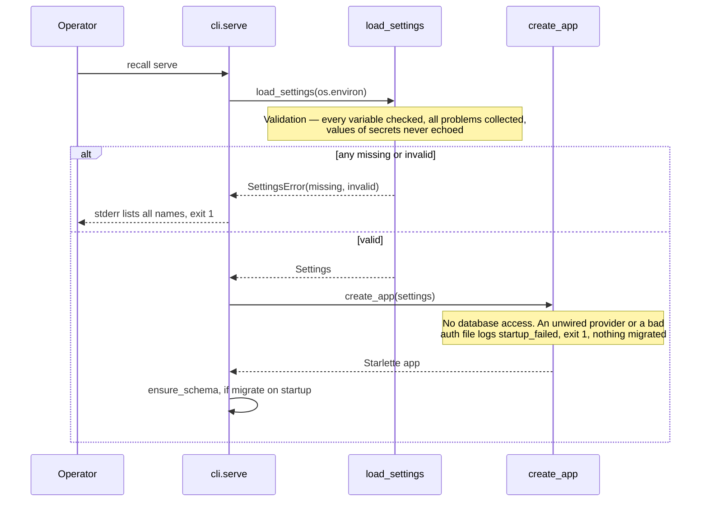
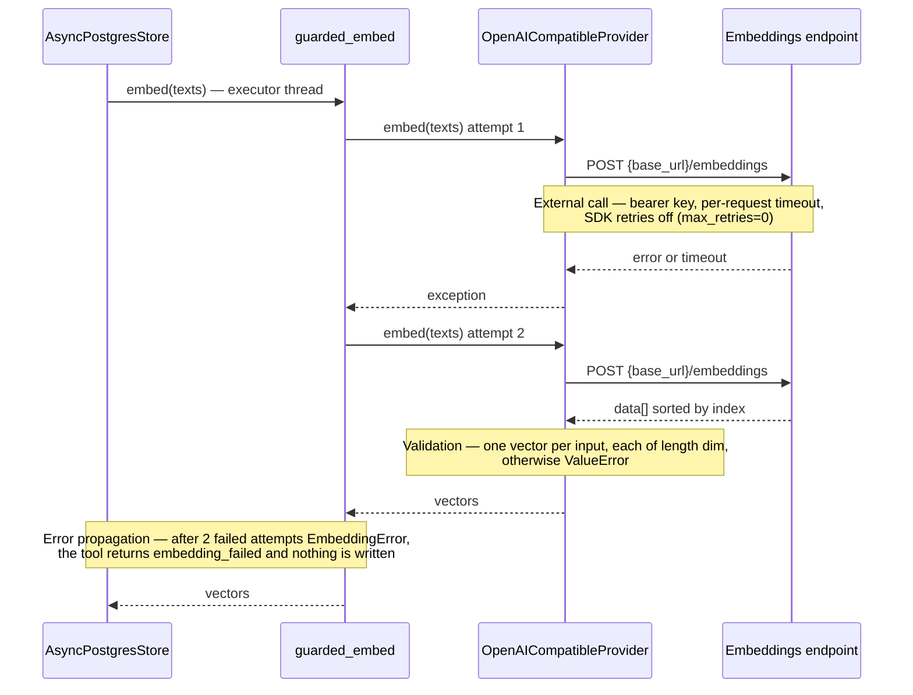
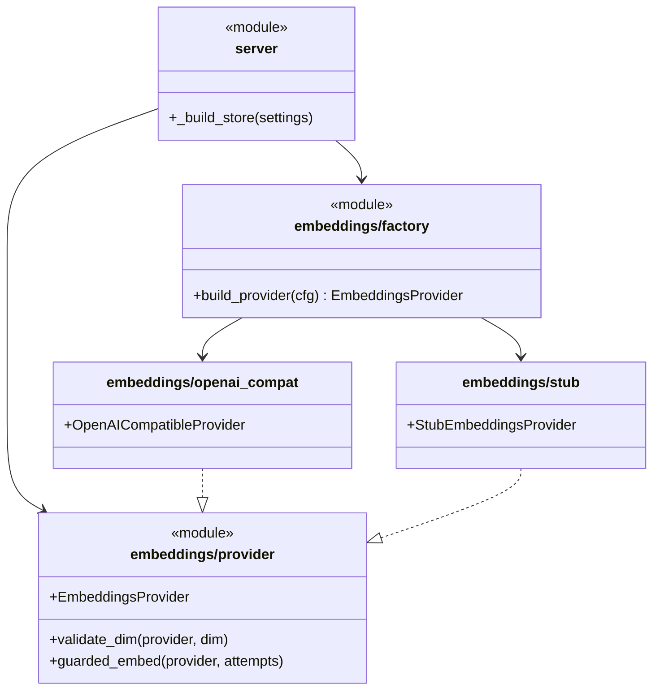
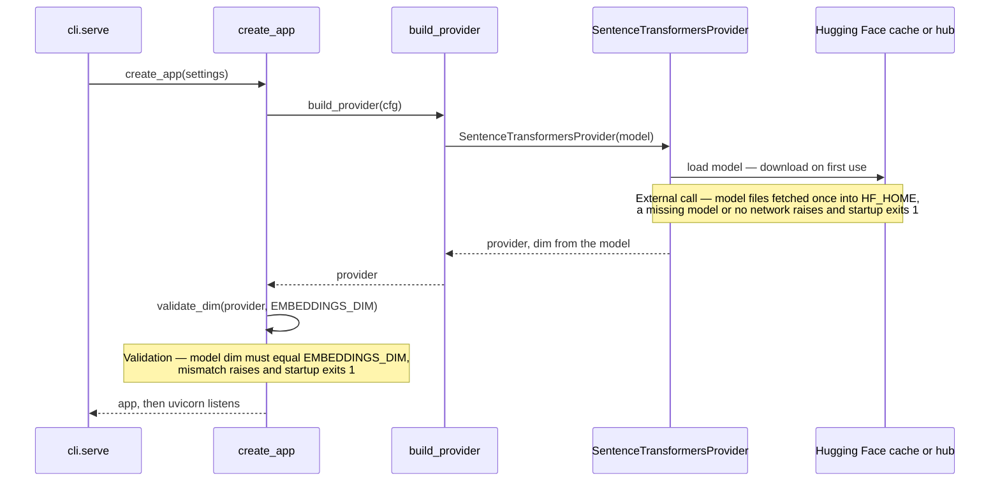
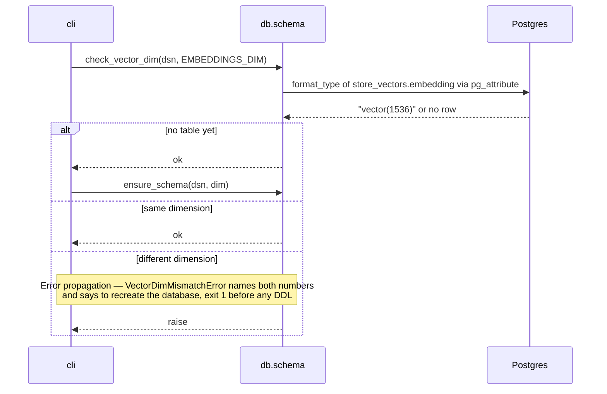
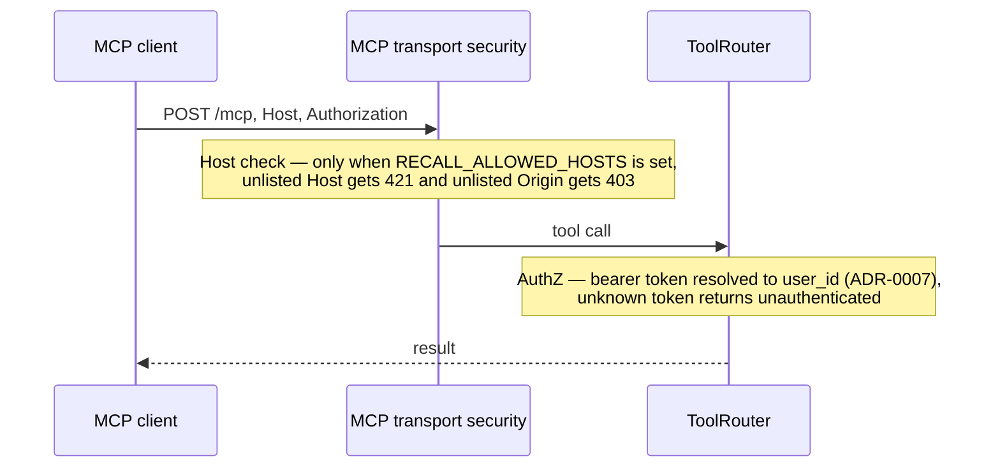
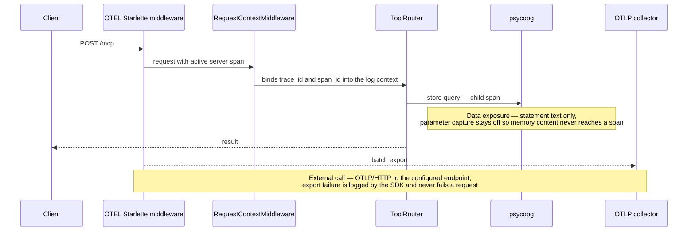
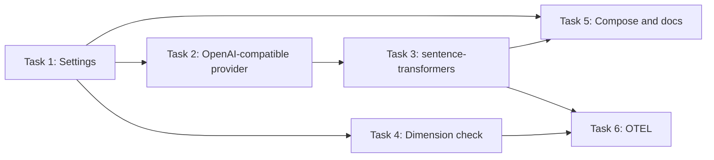

# LLD — Epic 4: Real deployment

## Document Control

| Field | Value |
|-------|-------|
| Epic | E4 — Real deployment |
| Phase | 4 |
| Epic issue | REC-14 |
| Task issues | REC-15 (§4.1), REC-16 (§4.2), REC-17 (§4.3), REC-18 (§4.4), REC-19 (§4.5), REC-20 (§4.6) |
| HLD components | Configuration, Embedder, Health Endpoints, MCP Transport, CLI, Tool Router (logging) |
| ADRs | 0006 (transport), 0007 (bearer auth), 0008 (+ amendment 1), 0011 (+ amendment 1), 0012 (real Postgres), 0013 (in-app DDL) |
| Status | Draft |
| Parent | [v2-design.md](../v2-design.md) |
| Requirements | Stories 1.3, 6.1, 6.3, 6.4, 6.5, 7.2, cross-cutting Observability — [requirements v0.6](../../requirements/v2-requirements.md) |
| Plan | [Phase 4](../../plans/2026-04-12-v2-implementation-plan.md) (E4.0 settings, E4.1 embeddings, E4.3 deployment, E4.2 OTEL) |
| Created | 2026-11-26 |

## Decisions taken at the architect gate (2026-11-26)

| # | Decision | Recorded in |
|---|----------|-------------|
| D1 | Both providers ship in Phase 4: OpenAI-compatible HTTP and in-process sentence-transformers. | ADR-0008 |
| D2 | A provider, model or dimension change means recreating the database. No re-embed command. | ADR-0008 amendment 1, Story 6.4 |
| D3 | Variables are `EMBEDDINGS_PROVIDER`, `_MODEL`, `_BASE_URL`, `_API_KEY`, `_DIM`. `RECALL_EMBEDDING_DIMS` and `OPENAI_API_KEY` are retired. | requirements v0.6 |
| D4 | `stub` is a valid `EMBEDDINGS_PROVIDER`, for tests and local development only. | Story 6.4 |
| D5 | `EMBEDDINGS_DIM` is required for every provider. The `vector(N)` column is fixed at creation, so the operator states N explicitly rather than inheriting a default (today's silent 1536). | §4.1 |
| D6 | The in-process model loads **before** the server listens. A load failure or dimension mismatch exits non-zero. No background loading and no "provider loading" state. | Story 6.3 |
| D7 | Retry lives in `guarded_embed`, one retry, any exception. The OpenAI SDK's own retries are off (`max_retries=0`). A deterministic failure (a malformed response) costs one pointless second call. Accepted to keep one retry rule. | ADR-0008 amendment 1 |
| D8 | `RECALL_ALLOWED_HOSTS` unset keeps today's behaviour (no Host check) in the server. Compose sets it to `localhost,127.0.0.1` by default, because the committed development token plus a local port is exactly the DNS-rebinding case the Host check exists for. Docs require it for any non-local deployment. | Story 6.4, §4.5 |
| D9 | Embedding spans come from `opentelemetry-instrumentation-openai-v2`, Postgres spans from the psycopg instrumentor, inbound from Starlette. | ADR-0011 amendment 1 |

## Open questions

| # | Question | Resolution |
|---|----------|------------|
| OQ1 | Estimated diffs above the 200-line target: Task 1 ~250, Task 2 ~220, Task 5 ~230 (about half of it Markdown). | **Not split.** Task 1's loader without its call sites ships dead code. Task 2's fixture is the only way to test the provider. Task 5 is mostly docs. Each split would add a sequential wave. Revisit at review if a PR exceeds ~300 lines of code. |
| OQ2 | Worst-case embed latency is 2 × `EMBEDDINGS_TIMEOUT_SECONDS` (default 10 s), and a merged search embeds twice (lld-e2-search OQ1), so one search can take ~40 s before failing. | **Accepted.** Documented in the env-var reference. Memoising the query embedding is out of scope. |
| OQ3 | BGE-family models recommend a query instruction prefix; the store calls one embed function for documents and queries. | **Accepted.** Recall embeds both the same way. Retrieval quality is unmeasured (backlog proposal: search-quality eval fixture). |
| OQ4 | Filtered recall at scale (`hnsw.ef_search`, lld-e2-search) | **Out of scope**, carried forward as a known limit in the plan. |

---

# Part A — Human-Reviewable Design

## 4.1 Settings and fail-fast startup

**Stories:** 6.1, 6.4 · **Layers:** BE

### Purpose

One typed `Settings` object, loaded once from the environment, replaces the scattered
`os.environ` reads in `cli.py`, `server.py` and `db/schema.py`. A missing or invalid variable
stops `recall serve` and `recall db migrate` with one message listing every problem.

### Behavioural flow



### Required variables

| Variable | Required when | Notes |
|----------|---------------|-------|
| `DATABASE_URL` | always | |
| `RECALL_AUTH_FILE` | always | Path to the token file (ADR-0007) |
| `EMBEDDINGS_PROVIDER` | always | `openai` · `sentence-transformers` · `stub` |
| `EMBEDDINGS_DIM` | always | Positive integer (D5) |
| `EMBEDDINGS_MODEL` | `openai`, `sentence-transformers` | |
| `EMBEDDINGS_BASE_URL`, `EMBEDDINGS_API_KEY` | `openai` | No implicit OpenAI endpoint (ADR-0008) |

Optional, with defaults: `RECALL_HOST` (`0.0.0.0`), `RECALL_PORT` (`8080`), `LOG_LEVEL`
(`INFO`), `RECALL_DB_MIGRATE_ON_STARTUP` (`true`), `EMBEDDINGS_TIMEOUT_SECONDS` (`10`),
`RECALL_ALLOWED_HOSTS` (empty), and the four `RECALL_*` search variables already in
`config.py`. `OTEL_*` variables are read by the OTEL SDK itself, not by `Settings`.
`recall db migrate` needs only `DATABASE_URL` and `EMBEDDINGS_DIM`.

### Invariants

| # | Invariant | Verification |
|---|-----------|-------------|
| I1 | Only `cli.main` touches the process environment: it passes `os.environ` once to the loaders and `configure_telemetry`. Everything else receives a mapping or `Settings`. | grep `os.environ` / `getenv` in `src/recall` — exactly one hit, in `cli.main` |
| I2 | `SettingsError` messages never contain the value of `EMBEDDINGS_API_KEY` or `DATABASE_URL` | unit test sets both to sentinel strings with an invalid sibling, asserts neither sentinel is in `str(err)` |
| I3 | `Settings.embeddings.api_key` is excluded from `repr` | unit test on `repr(settings)` |

Startup failures follow the same rule as I2. `schema_setup_failed`, `startup_failed` and
`store_unavailable` log the error type and the stack frames (`traceback.format_tb`: no message,
chained exception or local variable). A message is logged only if it cannot quote `DATABASE_URL`:
a `StartupError` (written by Recall) or a Postgres statement error with a SQLSTATE.

### Acceptance criteria

- [ ] `recall serve` with an empty environment exits 1, and stderr names `DATABASE_URL`, `RECALL_AUTH_FILE`, `EMBEDDINGS_PROVIDER` and `EMBEDDINGS_DIM` in one message, with no traceback.
- [ ] `EMBEDDINGS_PROVIDER=openai` without `EMBEDDINGS_BASE_URL` and `EMBEDDINGS_API_KEY` is rejected naming both.
- [ ] An unknown provider, a non-integer or non-positive `EMBEDDINGS_DIM`, a non-numeric port or timeout, or an out-of-bounds search variable is reported as invalid by variable name, with no traceback (including `RECALL_PORT=abc` for both `serve` and `db migrate`).
- [ ] `recall db migrate` without `EMBEDDINGS_DIM` exits 1 naming it.
- [ ] `ensure_schema` takes the dimension as a parameter, so the schema and the store use one value.
- [ ] `RECALL_EMBEDDING_DIMS` is read nowhere in `src/` or `tests/`.
- [ ] A provider that is not wired in this build stops `recall serve` with exit 1 before any migration, naming `EMBEDDINGS_PROVIDER`, the supported provider and the issue that adds each other one. Nothing falls back to the stub. `recall db migrate` is unaffected.
- [ ] A startup failure logs its stack frames, and no part of `DATABASE_URL` appears.

### BDD specs

```python
class TestLoadSettings:
    def test_empty_env_lists_every_always_required_variable(self): ...
    def test_openai_requires_base_url_and_api_key(self): ...
    def test_sentence_transformers_requires_model_only(self): ...
    def test_stub_requires_no_model(self): ...
    def test_invalid_dim_port_timeout_reported_by_name(self): ...
    def test_search_config_errors_are_folded_into_invalid(self): ...
    def test_allowed_hosts_split_on_commas_and_trimmed(self): ...
    def test_error_message_never_contains_secret_values(self): ...
    def test_api_key_not_in_repr(self): ...

class TestServeStartup:  # subprocess
    def test_serve_with_empty_env_exits_one_listing_missing(self): ...
    def test_db_migrate_without_dim_exits_one(self): ...
    def test_non_numeric_port_reported_by_name_without_traceback(self): ...
    def test_cli_flags_override_settings(self): ...

class TestUnwiredProvider:
    def test_create_app_refuses_naming_support_and_issue(self): ...
    def test_serve_exits_one_before_migrating(self): ...

class TestStartupFailureLocation:
    def test_store_open_failure_logs_frames_without_messages(self): ...
    def test_cli_failure_logs_frames_without_messages(self): ...
    def test_bad_auth_file_is_explained(self): ...
    def test_database_url_given_as_auth_file_is_not_echoed(self): ...
```

## 4.2 OpenAI-compatible provider, timeout and retry

**Stories:** 1.3, 6.4 · **Layers:** BE

### Purpose

The `openai` provider calls any OpenAI-compatible `/embeddings` endpoint. A provider factory
picks the provider from `Settings`. `guarded_embed` gains the single retry Story 1.3 requires,
and the per-request timeout comes from `EMBEDDINGS_TIMEOUT_SECONDS`.

### Behavioural flow



### Structural overview



### Invariants

| # | Invariant | Verification |
|---|-----------|-------------|
| I4 | One `embed` call reaches the provider at most twice | test with a provider double that always fails: exactly 2 calls, then `EmbeddingError` |
| I5 | The OpenAI client is built with `max_retries=0` | test: a fake endpoint that always returns 500 receives exactly 2 requests per `embed` |
| I6 | A response with the wrong count or vector length never reaches the store | test: fake endpoint returns 1 vector for 2 inputs, or wrong length — `embedding_failed`, no row written |
| I7 | The API key appears in no log line | test captures logs across a failing call, asserts the key sentinel is absent |

### Acceptance criteria

- [ ] With `EMBEDDINGS_PROVIDER=openai`, `memory_save` embeds through the configured endpoint and model.
- [ ] A first failure followed by a success saves the memory; two failures return `embedding_failed` and nothing is stored (Story 1.3 AC4/AC5).
- [ ] A response slower than `EMBEDDINGS_TIMEOUT_SECONDS` counts as a failed attempt.
- [ ] Vectors are returned in input order, using each item's `index`.
- [ ] `EMBEDDINGS_PROVIDER=stub` still wires the stub, so existing tests are unchanged.

### BDD specs

```python
class TestGuardedEmbedRetry:
    def test_success_on_first_attempt_calls_once(self): ...
    def test_failure_then_success_returns_vectors(self): ...
    def test_two_failures_raise_embedding_error(self): ...

class TestOpenAICompatibleProvider:  # against a fake endpoint served by uvicorn on localhost
    def test_posts_model_and_input_with_bearer_key(self): ...
    def test_orders_vectors_by_index(self): ...
    def test_wrong_vector_count_raises(self): ...
    def test_wrong_vector_length_raises(self): ...
    def test_timeout_raises_without_sdk_retry(self): ...
    def test_http_500_is_attempted_once_per_call(self): ...

class TestBuildProvider:
    def test_stub_and_openai_selected_from_settings(self): ...

@pytest.mark.integration
class TestSaveWithOpenAIProvider:
    def test_save_and_search_round_trip_through_fake_endpoint(self): ...
    def test_endpoint_down_returns_embedding_failed_and_stores_nothing(self): ...
```

## 4.3 In-process sentence-transformers provider

**Stories:** 6.3, 6.4 · **Layers:** BE

### Purpose

`EMBEDDINGS_PROVIDER=sentence-transformers` loads `EMBEDDINGS_MODEL` in-process with no API
key. The model loads while the app is composed, before uvicorn listens (D6), and its reported
dimension is checked against `EMBEDDINGS_DIM` there. The package is an optional extra
(`recall[local]`) on a CPU-only torch build, included in the Docker image by default.

### Behavioural flow



### Invariants

| # | Invariant | Verification |
|---|-----------|-------------|
| I8 | `sentence_transformers` is imported only inside `embeddings/local.py`, lazily | grep for the import outside `local.py`; unit test: importing `recall.server` with the module blocked succeeds |
| I9 | `encode` runs under one lock, so concurrent executor threads never share the model mid-call | unit test with a model double recording overlapping calls |
| I10 | torch resolves from the CPU index | `uv.lock` torch source is `https://download.pytorch.org/whl/cpu` (grep) |

### Acceptance criteria

- [ ] With the extra installed and a cached model, `memory_save` and `memory_search` work with no network and no API key.
- [ ] A model whose dimension differs from `EMBEDDINGS_DIM` stops startup with exit 1 naming both numbers.
- [ ] A missing extra stops startup with a message naming `recall[local]`. An unknown model stops startup with exit 1.
- [ ] Vectors are L2-normalised.
- [ ] The default Docker build includes the extra; `--build-arg RECALL_EXTRAS=` builds without it.
- [ ] CI's default runs skip tests marked `model`.

### BDD specs

```python
class TestSentenceTransformersProvider:
    def test_missing_extra_raises_naming_recall_local(self): ...      # module blocked in sys.modules
    def test_unknown_local_model_path_raises(self): ...               # no network needed
    def test_encode_calls_are_serialised(self): ...                   # model double

@pytest.mark.model  # downloads BAAI/bge-small-en-v1.5, excluded from CI
class TestWithRealModel:
    def test_dim_is_384_and_vectors_are_normalised(self): ...
    def test_similar_texts_score_higher_than_unrelated(self): ...

class TestStartupDimMismatch:
    def test_model_dim_differs_from_setting_exits_one(self): ...      # model double via factory
```

## 4.4 Vector dimension check against the database

**Stories:** 6.4 · **Layers:** BE, DB (read-only catalogue query)

### Purpose

Today `CREATE TABLE IF NOT EXISTS store_vectors` silently keeps an existing `vector(N)` column,
so a changed `EMBEDDINGS_DIM` fails only at the first write. Before applying DDL, `recall serve`
and `recall db migrate` read the existing column's dimension and stop if it differs.

### Behavioural flow



### Invariants

| # | Invariant | Verification |
|---|-----------|-------------|
| I11 | On mismatch, no DDL runs | integration test: mismatch, then assert `store` constraints and tables unchanged |
| I12 | The check runs before `ensure_schema` in both `serve` and `db migrate`, and runs in `serve` even when auto-migrate is off | integration tests for both commands and both migrate settings |

### Acceptance criteria

- [ ] A fresh database passes the check and is migrated.
- [ ] A database created with dimension 1536, then started with `EMBEDDINGS_DIM=384`, exits 1. The message names 1536 and 384, says to recreate the database, and says Recall does not re-embed.
- [ ] Matching dimensions start normally.

### BDD specs

```python
@pytest.mark.integration
class TestStoredVectorDim:
    def test_none_before_schema_exists(self): ...
    def test_reads_dim_after_ensure_schema(self): ...

@pytest.mark.integration
class TestDimCheckInCli:
    def test_db_migrate_mismatch_exits_one_before_ddl(self): ...
    def test_serve_mismatch_exits_one_with_migrate_off(self): ...
    def test_matching_dim_starts(self): ...   # serve --dry-run
```

## 4.5 Compose, allowed hosts and operator docs

**Stories:** 6.1, 6.4, 6.5, 7.2 · **Layers:** BE, ops, docs

### Purpose

A fresh clone runs `docker compose up` and gets a working, authenticated server on the
in-process provider with no API key. An optional `RECALL_ALLOWED_HOSTS` turns on the MCP SDK's
Host and Origin checks. `.env.example`, a variable reference page and the README match the
code, with tested client snippets for Claude Code and Cursor.

### Behavioural flow



`/healthz` and `/readyz` are Starlette routes outside the MCP sub-app, so probes that send a
pod IP as `Host` are never subject to the Host check.

### Invariants

| # | Invariant | Verification |
|---|-----------|-------------|
| I13 | Compose publishes ports on `127.0.0.1` only and sets `RECALL_ALLOWED_HOSTS` by default | grep `docker-compose.yml` for `127.0.0.1:` on every port and for the `RECALL_ALLOWED_HOSTS` default |
| I14 | Every variable `Settings` reads appears in `.env.example` and `docs/operations/env-vars.md` | unit test parses both files and compares with a `SETTINGS_VARIABLES` constant exported by `settings.py` |
| I15 | The committed development token is documented as development-only | grep README and env-var page for the warning next to `deploy/dev-auth.json` |

### Acceptance criteria

- [ ] `docker compose up` from a fresh clone starts Postgres and Recall, migrates, loads the default model and serves tools with the documented development token. Verified manually on the default build and recorded in the PR (CI cannot download the model on every run).
- [ ] The Compose stack rejects an MCP request with a foreign `Host` (DNS-rebinding guard for the committed development token).
- [ ] CI's compose smoke job (stub provider, slim build) runs `memory_save` then `memory_search` against the running stack.
- [ ] With `RECALL_ALLOWED_HOSTS=recall.example.com`, an MCP request with `Host: evil.example` gets 421; `Host: recall.example.com:8080` succeeds; `/healthz` with any Host succeeds.
- [ ] README and the env-var page carry a `claude mcp add --transport http` command, a `.mcp.json` example and a `.cursor/mcp.json` example, each with the Authorization header.

### BDD specs

```python
@pytest.mark.integration
class TestAllowedHosts:
    def test_unset_accepts_any_host(self): ...
    def test_listed_host_with_port_accepted(self): ...
    def test_unlisted_host_rejected_421(self): ...
    def test_unlisted_origin_rejected_403(self): ...
    def test_health_routes_ignore_host_check(self): ...
    # scripts/compose_smoke.py (CI) also asserts the Compose default rejects a foreign Host

class TestEnvDocs:
    def test_env_example_lists_every_settings_variable(self): ...
    def test_env_reference_lists_every_settings_variable(self): ...
```

## 4.6 OTEL export and instrumentation

**Stories:** cross-cutting Observability · **Layers:** BE

### Purpose

When `OTEL_EXPORTER_OTLP_ENDPOINT` is set, Recall exports traces over OTLP/HTTP with spans
for inbound HTTP (Starlette), Postgres (psycopg) and OpenAI-compatible embedding calls. Log
lines carry the active `trace_id` and `span_id`. Unset, nothing is installed (unchanged).

### Behavioural flow



### Invariants

| # | Invariant | Verification |
|---|-----------|-------------|
| I16 | With the endpoint unset, no tracer provider or instrumentor is installed | unit test: `configure_telemetry({})` returns False and the global provider is the default proxy |
| I17 | No span attribute contains memory content | integration test saves content with a sentinel, asserts the sentinel is in no exported span attribute |
| I18 | No hand-rolled spans (ADR-0011) | grep `start_as_current_span` / `start_span` in `src/recall` — no hits |
| I19 | `mcp_call` and `http_request` log lines carry the trace and span of the request's server span | integration test compares log fields with exported span ids |

### Acceptance criteria

- [ ] With the endpoint set, one `memory_save` call exports a server span with psycopg child spans, plus an embedding span when the provider is `openai`.
- [ ] Logs for that request carry the same `trace_id`.
- [ ] `OTEL_SERVICE_NAME` overrides the default service name `recall`.
- [ ] The Phase 0 "export unimplemented" warning is removed.

### BDD specs

```python
class TestConfigureTelemetry:
    def test_noop_when_endpoint_unset(self): ...

@pytest.mark.integration
class TestTracing:  # module-scoped in-memory exporter (global provider is set once per process)
    def test_save_exports_server_span_with_psycopg_children(self): ...
    def test_openai_provider_call_has_embedding_span(self): ...   # fake endpoint from §4.2
    def test_log_lines_carry_exported_trace_id(self): ...
    def test_no_span_attribute_contains_memory_content(self): ...
    def test_service_name_defaults_to_recall(self): ...
    def test_otel_service_name_overrides_default(self): ...

class TestPlaceholderRemoved:
    def test_endpoint_set_logs_no_export_unimplemented_warning(self): ...
```

---

# Part B — Agent Implementation Detail

## External Surfaces

| Surface | Version / revision | Doc URL | Verified | New to repo |
|---------|--------------------|---------|----------|-------------|
| `openai` Python SDK — `OpenAI(base_url, api_key, timeout, max_retries)`, `embeddings.create(input, model, encoding_format)` → `data[].embedding`, `data[].index` | `>=3.60,<4` (latest 3.60.0, 2026-11-26; `DEFAULT_MAX_RETRIES = 2`, HTTP via `httpx2`) | <https://github.com/openai/openai-python/blob/main/src/openai/resources/embeddings.py> | Yes — latest wheel inspected | No (dependency declared, never imported) |
| OpenAI-compatible `POST /embeddings` wire format | OpenAI API reference, 2026-11 | <https://platform.openai.com/docs/api-reference/embeddings/create> | Yes — via SDK types | Yes |
| `sentence-transformers` — `SentenceTransformer(model_name_or_path, device, cache_folder, local_files_only)`, `encode(..., normalize_embeddings=True)`, `get_embedding_dimension()` | `>=6.3,<7` (6.3.0, 2026-11-11; `get_sentence_embedding_dimension` is a deprecated alias) | <https://sbert.net/docs/package_reference/sentence_transformer/SentenceTransformer.html> | Yes — latest wheel inspected | Yes |
| `torch` CPU wheels | `>=2.15,<3` from `https://download.pytorch.org/whl/cpu` (2.15.0+cpu cp312 x86_64/aarch64 present) | <https://docs.astral.sh/uv/guides/integration/pytorch/> | Yes — index listing checked | Yes |
| Model `BAAI/bge-small-en-v1.5` | HF revision as of 2024-02-22, 384 dims, MIT | <https://huggingface.co/BAAI/bge-small-en-v1.5> | Yes — HF API | Yes |
| MCP SDK `TransportSecuritySettings(enable_dns_rebinding_protection, allowed_hosts, allowed_origins)`, `streamable_http_app(transport_security=...)` — exact or `host:*` matching, 421 / 403 | `mcp` 2.3.0 (latest), MCP 2026-07-28 revision | <https://github.com/modelcontextprotocol/python-sdk/blob/main/src/mcp/server/transport_security.py> | Yes — latest wheel inspected | Yes |
| `opentelemetry-sdk`, `-api`, `-exporter-otlp-proto-http` (`OTLPSpanExporter`) | `>=1.45.2,<2` | <https://opentelemetry.io/docs/languages/python/exporters/> | Yes — PyPI | Yes (exporter) |
| `opentelemetry-instrumentation-starlette` (`StarletteInstrumentor.instrument_app`) | `>=0.66b2,<1` | <https://opentelemetry-python-contrib.readthedocs.io/en/latest/instrumentation/starlette/starlette.html> | Yes — wheel | Yes |
| `opentelemetry-instrumentation-psycopg` (`PsycopgInstrumentor().instrument()`, wraps `psycopg.connect` and `AsyncConnection.connect`) | `>=0.66b2,<1` | <https://opentelemetry-python-contrib.readthedocs.io/en/latest/instrumentation/psycopg/psycopg.html> | Yes — wheel | Yes |
| `opentelemetry-instrumentation-openai-v2` (`OpenAIInstrumentor().instrument()`, wraps `Embeddings.create`) | `>=2.4b0,<3` (beta, 2026-05-01, needs `opentelemetry-instrumentation~=0.60b0`) | <https://pypi.org/project/opentelemetry-instrumentation-openai-v2/> | Yes — wheel | Yes |
| Claude Code `claude mcp add --transport http <name> <url> --header "Authorization: Bearer …"`, `.mcp.json` `type: "http"`, `url`, `headers`, `${VAR}` expansion | docs as of 2026-11-26 | <https://code.claude.com/docs/en/mcp> | Yes | Yes |
| Cursor `.cursor/mcp.json` / `~/.cursor/mcp.json` with `url`, `headers`, `${env:NAME}` | docs as of 2026-11-26 | <https://cursor.com/docs/context/mcp> | Yes | Yes |
| `uv` image `ghcr.io/astral-sh/uv` | `0.13.10` (pin; today `:latest`) | <https://docs.astral.sh/uv/guides/integration/docker/> | Yes — PyPI | No |

## Reused helpers — DO NOT re-implement

| Helper | Import path | Instead of |
|--------|-------------|------------|
| `EmbeddingsProvider`, `validate_dim`, `guarded_embed` | `recall.embeddings.provider` | A second provider base class, inline dim checks, a retry loop inside a provider |
| `StubEmbeddingsProvider` | `recall.embeddings.stub` | Any new test embedder |
| `load_search_config`, `SearchConfig` | `recall.config` | Re-parsing the `RECALL_*` search variables |
| `load_auth_config` | `recall.auth` | Reading the token file elsewhere |
| `ensure_schema` | `recall.db.schema` | Raw DDL in the CLI |
| `EmbeddingError`, `ErrorCode` | `recall.errors` | New wire error codes (none are added in this epic) |
| `configure_logging`, `bind_request_context` | `recall.logging` | Any `logging.getLogger(...).info` or second logger |
| `get_trace_context` | `recall.telemetry` | Reading OTEL span context elsewhere |

<a id="LLD-e4-settings"></a>

## 4.1 Settings and fail-fast startup — Implementation

### File structure

```text
src/recall/settings.py       — new: Settings, EmbeddingsSettings, DbSettings, SettingsError, loaders
src/recall/cli.py            — serve/db migrate load settings, print SettingsError, exit 1
src/recall/server.py         — create_app(settings: Settings); _build_store(settings); no os.environ
src/recall/db/schema.py      — ensure_schema(conn_string, dims); _index_config(dims); describe_db_error(exc)
src/recall/errors.py         — StartupError(ValueError): a startup message that is safe to log
src/recall/logging.py        — stack_frames(exc) -> list[str]
src/recall/config.py         — unchanged (SearchConfig stays here)
tests/test_settings.py       — new
tests/test_startup.py        — new: unwired providers, startup failure logging
tests/conftest.py            — make_settings(...) helper; app_factory builds Settings; EMBEDDINGS_DIM
tests/test_cli.py, tests/test_health.py, tests/test_schema.py — call-site updates
tests/test_memory_service.py, tests/evaluation/test_e16_tool_router_eval.py — RECALL_EMBEDDING_DIMS → EMBEDDINGS_DIM
                             (conftest._embedding_dims() reads EMBEDDINGS_DIM, test default 1536,
                              app_factory's env juggling is replaced by make_settings)
.env.example                 — rewritten to the §4.1 table (final prose in §4.5)
```

### Types and signatures

```python
# settings.py
ProviderName = Literal["openai", "sentence-transformers", "stub"]

@dataclass(frozen=True)
class EmbeddingsSettings:
    provider: ProviderName
    dim: int
    model: str | None = None
    base_url: str | None = None
    api_key: str | None = field(default=None, repr=False)
    timeout_seconds: float = 10.0

@dataclass(frozen=True)
class Settings:
    database_url: str = field(repr=False)
    auth_file: str
    embeddings: EmbeddingsSettings
    search: SearchConfig
    host: str = "0.0.0.0"  # noqa: S104 — container convention (cli.py)
    port: int = 8080
    log_level: str = "INFO"
    migrate_on_startup: bool = True
    allowed_hosts: tuple[str, ...] = ()

@dataclass(frozen=True)
class DbSettings:
    database_url: str = field(repr=False)
    embeddings_dim: int

class SettingsError(Exception):
    def __init__(self, missing: Sequence[str] = (), invalid: Sequence[str] = ()) -> None: ...
    # str(): "missing required environment variables: A, B" and/or "invalid: X (reason), ..."
    # `invalid` entries carry the variable name and a reason, never the value.

SETTINGS_VARIABLES: tuple[str, ...]  # every name load_settings reads — used by §4.5 doc tests

def load_settings(env: Mapping[str, str]) -> Settings: ...
def load_db_settings(env: Mapping[str, str]) -> DbSettings: ...
```

Private helpers (≤ 20 lines each): `_require(env, names, missing) -> dict[str, str]`,
`_parse_int(env, name, invalid, *, minimum) -> int | None`, `_parse_float(...)`,
`_parse_bool(env, name, default) -> bool` (moves `_FALSY_ENV_VALUES` from `cli.py`),
`_parse_hosts(raw) -> tuple[str, ...]`, `_embeddings(env, missing, invalid) -> EmbeddingsSettings | None`.
`load_settings` collects into `missing`/`invalid` lists and raises once at the end. For the search
variables it checks that each value parses, then runs `load_search_config` once per rule group
(boost bounds; default limit against max limit), so every bad variable is named with a value-free
reason. `config.py`'s own message quotes the value and stops at the first problem.

### CLI decomposition

```text
_cmd_serve(args, env):                                         # env = os.environ, passed from main
    configure_logging(args.log_level or "INFO"); configure_telemetry(env)   # §4.6 adds instrument_app
    settings = _load_or_exit(load_settings, env)               # SettingsError → stderr "error: …", exit 1
    settings = _apply_flags(settings, args)                    # only flags actually given override
    app = create_app(settings)                                 # any exception: log startup_failed, exit 1
    if settings.migrate_on_startup: asyncio.run(ensure_schema(settings.database_url, settings.embeddings.dim))
                                                               # failure: log schema_setup_failed, exit 1
    ...uvicorn.run(app, host=settings.host, port=settings.port, log_config=None)

_cmd_db_migrate(args, env): db = _load_or_exit(load_db_settings, env); ensure_schema(db.database_url, db.embeddings_dim)
                            # §4.4 replaces both ensure_schema calls with _prepare_database
```

`main(argv)` sets `env = os.environ` once and passes it down. The `--host/--port/--log-level`
flags default to `None` (no env read at parser build time, so `RECALL_PORT=abc` reaches
`load_settings` and is reported by name). `_apply_flags(settings, args) -> Settings` replaces only
fields whose flag is not `None`. `configure_logging` first runs with `args.log_level or "INFO"`
and is reconfigured with `settings.log_level` once settings load. The `database_url_unset`
warning path is deleted: `DATABASE_URL` is now required.

> **Constraint:** until §4.2 and §4.3 wire them, `_build_store` raises `StartupError` for
> `openai` and `sentence-transformers`. `create_app` also turns an unreadable or invalid auth
> file into `StartupError`, without quoting the configured path.
>
> **Constraint:** `create_app(settings)` replaces `create_app(conn_string)`.
> `app.state.conn_string = settings.database_url` stays for the health handlers.
> `_load_auth_config` becomes `load_auth_config(settings.auth_file)`; the
> `auth_unconfigured` empty-map fallback is deleted (the file is required).
>
> **Constraint:** `test_serve_dry_run_exits_cleanly` must now pass a full stub environment
> with `RECALL_DB_MIGRATE_ON_STARTUP=false` and a non-existent but well-formed `DATABASE_URL`.
> §4.4 later turns it into an integration test.

<a id="LLD-e4-openai-provider"></a>

## 4.2 OpenAI-compatible provider — Implementation

### File structure

```text
src/recall/embeddings/openai_compat.py — new: OpenAICompatibleProvider
src/recall/embeddings/factory.py       — new: build_provider(cfg)
src/recall/embeddings/provider.py      — guarded_embed(provider, *, attempts=2)
src/recall/server.py                   — _build_store uses build_provider + validate_dim
tests/test_openai_provider.py          — new, with a fake_embeddings_endpoint fixture
tests/test_embeddings.py               — retry cases
tests/test_e2e_openai_provider.py      — new, integration
```

### Signatures

```python
class OpenAICompatibleProvider(EmbeddingsProvider):
    def __init__(self, *, model: str, base_url: str, api_key: str, dim: int,
                 timeout_seconds: float) -> None:
        # OpenAI(base_url=..., api_key=..., timeout=timeout_seconds, max_retries=0)
    def embed(self, texts: list[str]) -> list[list[float]]:
        # client.embeddings.create(input=texts, model=model, encoding_format="float")
        # sort data by .index, then _check_shape(vectors, len(texts), dim)

def _check_shape(vectors: list[list[float]], expected_count: int, dim: int) -> None  # ValueError

def build_provider(cfg: EmbeddingsSettings) -> EmbeddingsProvider:
    # match cfg.provider: "stub" → StubEmbeddingsProvider(dim=cfg.dim)
    #                     "openai" → OpenAICompatibleProvider(...)
    #                     "sentence-transformers" → raise RuntimeError("lands in §4.3")  (replaced by §4.3)
    # end with assert_never(cfg.provider)

def guarded_embed(provider: EmbeddingsProvider, *, attempts: int = 2
                  ) -> Callable[[Sequence[str]], list[list[float]]]:
    # loop: success returns. Failure logs "embedding_attempt_failed"
    # (provider, attempt, error_type — not the message). After the last attempt,
    # log.exception("embedding_provider_failed") (event name kept) and
    # raise EmbeddingError() from the last exception.
```

> **Constraint:** do not pass `dimensions=` to `embeddings.create`. Not every OpenAI-compatible
> server accepts it; the shape check enforces `EMBEDDINGS_DIM` instead.
>
> **Constraint (test seam):** no `http_client=` or transport injection into the provider.
> `respx` cannot mock `httpx2`, so tests run a real fake endpoint: a Starlette app served by
> uvicorn on `127.0.0.1:<free port>` in a background thread (`fake_embeddings_endpoint`
> fixture in `tests/conftest.py`). It records requests and is scripted per test (status,
> delay, payload). §4.6 reuses it.

<a id="LLD-e4-local-provider"></a>

## 4.3 sentence-transformers provider — Implementation

### File structure

```text
src/recall/embeddings/local.py     — new: SentenceTransformersProvider
src/recall/embeddings/factory.py   — "sentence-transformers" branch
pyproject.toml                     — [project.optional-dependencies] local; uv index; mypy override; pytest marker
uv.lock                            — regenerated
Dockerfile                         — RECALL_EXTRAS build arg, HF_HOME, healthcheck start period, pinned uv
.github/workflows/ci.yml           — unit job: -m "not integration and not model"
tests/test_local_provider.py       — new
```

### Signatures

```python
class _Encoder(Protocol):
    def encode(self, sentences: list[str], *, normalize_embeddings: bool, convert_to_numpy: bool) -> Any: ...
    def get_embedding_dimension(self) -> int | None: ...

def _load_model(model: str) -> _Encoder:
    # lazy: from sentence_transformers import SentenceTransformer
    #   ImportError → RuntimeError("EMBEDDINGS_PROVIDER=sentence-transformers needs the recall[local] extra")
    # return SentenceTransformer(model)   # uses HF_HOME, downloads on first use

class SentenceTransformersProvider(EmbeddingsProvider):
    def __init__(self, *, model: str) -> None:
        # self._model = _load_model(model)
        # self._dim = self._model.get_embedding_dimension()  — None → ValueError
        # self._lock = threading.Lock()
    @property
    def dim(self) -> int: ...
    def embed(self, texts: list[str]) -> list[list[float]]:
        # with self._lock: self._model.encode(texts, normalize_embeddings=True, convert_to_numpy=True).tolist()
```

> **Constraint (test seam):** tests replace `recall.embeddings.local._load_model` with
> `monkeypatch` to supply a model double (I9, dim-mismatch startup). The missing-extra test
> blocks the import with `monkeypatch.setitem(sys.modules, "sentence_transformers", None)`.
> `test_unknown_local_model_path_raises` needs the real package, so it starts with
> `pytest.importorskip("sentence_transformers")`.
>
> **Constraint (why the lock):** the fast tokenizer raises "Already borrowed" under concurrent
> use, so `encode` is serialised. In-process throughput is one batch at a time, adequate for
> one team. Higher load is what the `openai` provider is for.

`create_app` → `_build_store` → `build_provider` → `validate_dim(provider, cfg.dim)` already
runs at composition time, so D6 needs no new call site. A mismatch (`StartupError`) or a load
error propagates to `cli._cmd_serve`, which logs `startup_failed` and exits 1 (§4.1). Only a
`StartupError` message is logged, so the missing-extra and model-load failures must raise
`StartupError` with a message Recall writes. §4.2 and §4.3 each remove their provider from the
unwired refusal in `_build_store`.

### Packaging

```toml
[project.optional-dependencies]
local = ["sentence-transformers>=6.3,<7", "torch>=2.15,<3"]

[[tool.uv.index]]
name = "pytorch-cpu"
url = "https://download.pytorch.org/whl/cpu"
explicit = true

[tool.uv.sources]
torch = [{ index = "pytorch-cpu" }]

[[tool.mypy.overrides]]
module = ["sentence_transformers.*"]
ignore_missing_imports = true
```

Add the `model` marker to `[tool.pytest.ini_options].markers`.

Dockerfile: `COPY --from=ghcr.io/astral-sh/uv:0.13.10`; `ARG RECALL_EXTRAS=local`; builder runs
`uv sync --frozen --no-dev` plus `--extra "$RECALL_EXTRAS"` when non-empty (drop the
`|| uv sync --no-dev` fallback, which hides lock drift); runtime `ENV HF_HOME=/app/.cache/huggingface`
created with `mkdir -p "$HF_HOME"` before the `chown -R recall:recall /app` (otherwise a named
volume mounted there is root-owned and the download fails); `HEALTHCHECK --start-period=120s`
(first boot downloads the model).

Cost of the default build: CPU torch plus sentence-transformers add several hundred MB to the
image, and the first boot downloads the model (~130 MB for the Compose default). Operators on
the `openai` provider build with `--build-arg RECALL_EXTRAS=` for a slim image.

<a id="LLD-e4-dim-check"></a>

## 4.4 Vector dimension check — Implementation

```python
# db/schema.py
class VectorDimMismatchError(Exception):
    def __init__(self, stored: int, configured: int) -> None: ...
    # "EMBEDDINGS_DIM=384 but store_vectors.embedding is vector(1536). Changing the embedding
    #  model or dimension needs a fresh database: recreate it (or point DATABASE_URL at a new
    #  one) and start again. Recall does not re-embed existing memories (ADR-0008)."

_STORED_DIM_SQL = """
SELECT format_type(a.atttypid, a.atttypmod)
  FROM pg_attribute a
 WHERE a.attrelid = to_regclass('store_vectors')
   AND a.attname = 'embedding' AND NOT a.attisdropped
"""

async def stored_vector_dim(conn_string: str) -> int | None   # parse r"vector\((\d+)\)", None when no row
async def check_vector_dim(conn_string: str, configured: int) -> None   # raises VectorDimMismatchError
```

CLI: one helper `_prepare_database(database_url, dim, *, migrate: bool) -> None` runs
`check_vector_dim` and then, if `migrate`, `ensure_schema`. Both commands call it
(`db migrate` with `migrate=True`). `serve` calls it after `create_app`, as it does
`ensure_schema` today (§4.1). `VectorDimMismatchError` → stderr message, exit 1; other
errors keep today's `schema_setup_failed` handling.

> **Constraint:** `serve` now always connects to Postgres before listening.
> `test_serve_dry_run_exits_cleanly` moves to an integration test using `postgres_dsn`.

Accepted trade-off: a database that is down at startup now gives exit 1 (an orchestrator
restarts it) rather than a live process whose `/readyz` returns 503. Once running, a lost
database still shows as 503 on `/readyz`.

<a id="LLD-e4-deployment"></a>

## 4.5 Compose, allowed hosts and docs — Implementation

### File structure

```text
docker-compose.yml               — auth file mount, provider env with defaults, HF cache volume, 127.0.0.1 ports
deploy/dev-auth.json             — new: {"dev-token": {"user_id": "dev"}} — development only
src/recall/server.py             — _transport_security(allowed_hosts); pass to streamable_http_app
.env.example                     — final form, every SETTINGS_VARIABLES entry, grouped and commented
docs/operations/env-vars.md      — new: variable reference, client snippets, latency note (OQ2)
README.md                        — Compose quick start, client setup, link to env-vars page
scripts/compose_smoke.py         — new: memory_save then memory_search over /mcp with the dev token
.github/workflows/ci.yml         — compose-smoke job
tests/test_allowed_hosts.py, tests/test_env_docs.py — new
```

### Compose (recall service)

```yaml
build:
  context: .
  args: { RECALL_EXTRAS: "${RECALL_EXTRAS:-local}" }
environment:
  DATABASE_URL: postgresql://recall:recall@db:5432/recall
  RECALL_AUTH_FILE: /run/recall/auth.json
  EMBEDDINGS_PROVIDER: "${EMBEDDINGS_PROVIDER:-sentence-transformers}"
  EMBEDDINGS_MODEL: "${EMBEDDINGS_MODEL:-BAAI/bge-small-en-v1.5}"
  EMBEDDINGS_DIM: "${EMBEDDINGS_DIM:-384}"
  RECALL_ALLOWED_HOSTS: "${RECALL_ALLOWED_HOSTS:-localhost,127.0.0.1}"
volumes:
  - ./deploy/dev-auth.json:/run/recall/auth.json:ro
  - hf-cache:/app/.cache/huggingface
ports: ["127.0.0.1:8080:8080"]
```

Postgres ports become `127.0.0.1:5432:5432`.

### Allowed hosts

```python
def _transport_security(allowed_hosts: tuple[str, ...]) -> TransportSecuritySettings | None:
    # () → None (SDK default for host="0.0.0.0": protection off)
    # else enable_dns_rebinding_protection=True,
    #      allowed_hosts=[h, f"{h}:*" for each h],
    #      allowed_origins=[f"{s}://{h}", f"{s}://{h}:*" for s in ("http", "https") for each h]
```

### CI compose smoke

```yaml
compose-smoke:
  needs: [unit-tests, integration-tests]
  env: { EMBEDDINGS_PROVIDER: stub, RECALL_EXTRAS: "" }
  steps: checkout → setup-uv → docker compose up -d --build --wait
         → uv run python scripts/compose_smoke.py → docker compose logs (on failure) → down -v
```

`scripts/compose_smoke.py` uses the MCP SDK client the same way `tests/test_e2e_phase1.py`
does. Read that file for the stateless 2026-07-28 call pattern; do not hand-build JSON-RPC.

### Client snippets (README and env-var page)

```bash
claude mcp add --transport http recall http://localhost:8080/mcp \
  --header "Authorization: Bearer dev-token"
```

`.mcp.json` (project scope): `{"mcpServers": {"recall": {"type": "http", "url": "http://localhost:8080/mcp", "headers": {"Authorization": "Bearer ${RECALL_TOKEN}"}}}}`.
`.cursor/mcp.json`: the same entry without `type`, using `"Bearer ${env:RECALL_TOKEN}"`.

<a id="LLD-e4-tracing"></a>

## 4.6 OTEL export and instrumentation — Implementation

### Signatures

```python
# telemetry.py
def configure_telemetry(env: Mapping[str, str], *, span_exporter: SpanExporter | None = None) -> bool:
    # no endpoint and no exporter → return False (no-op, unchanged)
    # attrs = {} if env.get("OTEL_SERVICE_NAME") else {"service.name": "recall"}
    # TracerProvider(resource=Resource.create(attrs))   # create() attrs override the env detector,
    #                                                  # so service.name is set only when OTEL_SERVICE_NAME is unset
    # add BatchSpanProcessor(span_exporter or OTLPSpanExporter())           # exporter reads OTEL_EXPORTER_OTLP_*
    # trace.set_tracer_provider(provider)
    # PsycopgInstrumentor().instrument()       # before create_app, so the store pool's connects are wrapped
    # OpenAIInstrumentor().instrument()        # content capture left at its default (off)
    # return True

def instrument_app(app: Starlette) -> None:  # StarletteInstrumentor.instrument_app(app)

def get_trace_context() -> tuple[str, str]  # unchanged
```

CLI order: `configure_logging` → `enabled = configure_telemetry(env)` →
`load_settings` → `create_app` → `_prepare_database` → `if enabled: instrument_app(app)` →
uvicorn. `span_exporter` is a genuine behavioural dependency for tests (in-memory exporter),
not an HTTP seam.

> **Constraint:** never pass `capture_parameters=True` to the psycopg instrumentor (I17).
>
> **Constraint:** `set_tracer_provider` is once per process. Tracing tests share one
> module-scoped provider with an `InMemorySpanExporter` and call `force_flush()` before asserting.
>
> **Constraint (verify by test, I19):** `instrument_app` adds the OTEL middleware with
> `add_middleware`, which Starlette places outermost, so the server span is active when
> `RequestContextMiddleware` binds `trace_id`. If the test shows empty ids, move the
> instrumentation into `create_app` ahead of `RequestContextMiddleware` and note it in lld-sync.
> That fallback edits `server.py`, which Task 5 edits in the same wave: rebase onto Task 5's
> merge first.

Dependencies: `opentelemetry-exporter-otlp-proto-http>=1.45.2,<2`,
`opentelemetry-instrumentation-starlette>=0.66b2,<1`,
`opentelemetry-instrumentation-psycopg>=0.66b2,<1`,
`opentelemetry-instrumentation-openai-v2>=2.4b0,<3`.

## kb/ additions

Paste into `kb/architecture.md` (each task adds its own line when it lands):

```markdown
## Settings and deployment (E4)

- `src/recall/settings.py` — `load_settings(env)` / `load_db_settings(env)` are the only environment readers; only `cli.main` touches `os.environ` and passes it down. Add a variable here, to `SETTINGS_VARIABLES`, `.env.example` and `docs/operations/env-vars.md` together (`tests/test_env_docs.py` enforces it).
- `recall.embeddings.factory.build_provider(cfg)` — the one place a provider is chosen. Providers make one attempt; retry and timeout policy live in `guarded_embed` and the provider's client timeout.
- `recall.db.schema.check_vector_dim(dsn, dim)` — runs before `ensure_schema`. A dimension change means a new database; there is no re-embed path (ADR-0008 amendment 1).
- `recall.telemetry.configure_telemetry(env)` / `instrument_app(app)` — auto-instrumentation only (ADR-0011 amendment 1). No hand-rolled spans.
```

Also correct `kb/architecture.md`'s migration paragraph: there is no `src/recall/migrations/`
directory (ADR-0013 revised), and `kb/file-map.md`'s `migrations` row should be removed (§4.1 task).

---

## Cross-References

### Internal

- §4.2 depends on §4.1 (`EmbeddingsSettings`, `create_app(settings)`).
- §4.3 depends on §4.2 (`build_provider`).
- §4.4 depends on §4.1 only (`load_db_settings`, CLI shape).
- §4.5 depends on §4.1 (`SETTINGS_VARIABLES`, `allowed_hosts`) and §4.3 (Docker build arg, default model).
- §4.6 depends on §4.2 (fake endpoint fixture) and follows §4.3/§4.4 in `pyproject.toml`, `uv.lock` and `cli.py`.

### External

- [lld-e2-search.md](lld-e2-search.md) — OQ1 (two embeds per merged search), filtered-recall risk.
- [lld-e3-update-delete-errors.md](lld-e3-update-delete-errors.md) §3.4 — `guarded_embed` and `embedding_failed`.
- [lld-e06-health-logging.md](lld-e06-health-logging.md) — health handlers and request-context middleware.

### Shared types

`Settings`, `EmbeddingsSettings` (§4.1) are consumed by every later section.

---

## Tasks

### Task 1: Settings and fail-fast startup

**Issue title:** E4.0: Settings loader and fail-fast startup
**Layer:** BE
**Depends on:** —
**Stories:** 6.1, 6.4

**What:** Add `settings.py` and route `cli.py`, `server.py` and `db/schema.py` through it. Rename to `EMBEDDINGS_*`.

**Acceptance criteria:** §4.1 Acceptance criteria and invariants I1–I3.

**BDD specs:** §4.1 BDD specs.

**Files to create/modify:** `src/recall/settings.py` (new), `src/recall/cli.py`, `src/recall/server.py`,
`src/recall/db/schema.py`, `tests/test_settings.py` (new), `tests/conftest.py`, `tests/test_cli.py`,
`tests/test_health.py`, `tests/test_schema.py`, `tests/test_memory_service.py`,
`tests/evaluation/test_e16_tool_router_eval.py`, `.env.example`, `kb/file-map.md`, `kb/architecture.md`.

### Task 2: OpenAI-compatible provider with timeout and retry

**Issue title:** E4.1a: OpenAI-compatible embeddings provider, timeout and single retry
**Layer:** BE
**Depends on:** Task 1
**Stories:** 1.3, 6.4

**What:** Add `OpenAICompatibleProvider` and `build_provider`, add retry to `guarded_embed`, wire the factory into `_build_store`.

**Acceptance criteria:** §4.2 Acceptance criteria and invariants I4–I7.

**BDD specs:** §4.2 BDD specs.

**Files to create/modify:** `src/recall/embeddings/openai_compat.py` (new), `src/recall/embeddings/factory.py` (new),
`src/recall/embeddings/provider.py`, `src/recall/server.py`, `tests/conftest.py` (fake endpoint fixture),
`tests/test_openai_provider.py` (new), `tests/test_embeddings.py`, `tests/test_e2e_openai_provider.py` (new).

### Task 3: In-process sentence-transformers provider

**Issue title:** E4.1b: sentence-transformers in-process provider and CPU-only packaging
**Layer:** BE
**Depends on:** Task 2
**Stories:** 6.3, 6.4

**What:** Add the provider behind the `local` extra on CPU torch, the factory branch, Docker build arg and model test marker.

**Acceptance criteria:** §4.3 Acceptance criteria and invariants I8–I10.

**BDD specs:** §4.3 BDD specs.

**Files to create/modify:** `src/recall/embeddings/local.py` (new), `src/recall/embeddings/factory.py`,
`pyproject.toml`, `uv.lock`, `Dockerfile`, `.github/workflows/ci.yml`, `tests/test_local_provider.py` (new).

### Task 4: Vector dimension check against the database

**Issue title:** E4.1c: Fail fast when EMBEDDINGS_DIM differs from the stored vector column
**Layer:** BE
**Depends on:** Task 1
**Stories:** 6.4

**What:** Add `stored_vector_dim` and `check_vector_dim`, and run them before `ensure_schema` in `serve` and `db migrate`.

**Acceptance criteria:** §4.4 Acceptance criteria and invariants I11–I12.

**BDD specs:** §4.4 BDD specs.

**Files to create/modify:** `src/recall/db/schema.py`, `src/recall/cli.py`, `tests/test_schema.py`, `tests/test_cli.py`.

### Task 5: Compose, allowed hosts and operator docs

**Issue title:** E4.3: Compose out of the box, RECALL_ALLOWED_HOSTS, env-var reference and client snippets
**Layer:** BE, ops, docs
**Depends on:** Task 1, Task 3
**Stories:** 6.1, 6.4, 6.5, 7.2

**What:** Make Compose authenticated and keyless, wire `RECALL_ALLOWED_HOSTS` into the MCP transport, add the CI compose smoke job and finish the operator docs.

**Acceptance criteria:** §4.5 Acceptance criteria and invariants I13–I15.

**BDD specs:** §4.5 BDD specs.

**Files to create/modify:** `docker-compose.yml`, `deploy/dev-auth.json` (new), `src/recall/server.py`, `.env.example`,
`docs/operations/env-vars.md` (new), `README.md`, `scripts/compose_smoke.py` (new), `.github/workflows/ci.yml`,
`tests/test_allowed_hosts.py` (new), `tests/test_env_docs.py` (new).

### Task 6: OTEL export and instrumentation

**Issue title:** E4.2: OTLP export with Starlette, psycopg and OpenAI instrumentation
**Layer:** BE
**Depends on:** Task 3, Task 4
**Stories:** cross-cutting Observability

**What:** Replace the Phase 0 placeholder with OTLP export and auto-instrumentation, verified end to end with an in-memory exporter.

**Acceptance criteria:** §4.6 Acceptance criteria and invariants I16–I19.

**BDD specs:** §4.6 BDD specs.

**Files to create/modify:** `src/recall/telemetry.py`, `src/recall/cli.py`, `pyproject.toml`, `uv.lock`,
`tests/test_telemetry.py` (new), `tests/test_health.py` (remove the Phase 0 OTEL placeholder tests it replaces).

---

## Execution Order

### Dependency DAG



### Execution Waves

| Wave | Tasks | Blocked by | Notes |
|------|-------|------------|-------|
| 1 | Task 1 | — | Every later task consumes `Settings` |
| 2 | Task 2, Task 4 | Wave 1 | Parallel — Task 2 edits `embeddings/`, `server.py`, `conftest.py`, Task 4 edits `db/schema.py`, `cli.py` and their tests |
| 3 | Task 3 | Wave 2 (Task 2) | Needs `build_provider` |
| 4 | Task 5, Task 6 | Wave 3 | Parallel — Task 5 edits `server.py` and `ci.yml`, Task 6 edits `telemetry.py`, `cli.py`, `pyproject.toml`, `uv.lock` |
